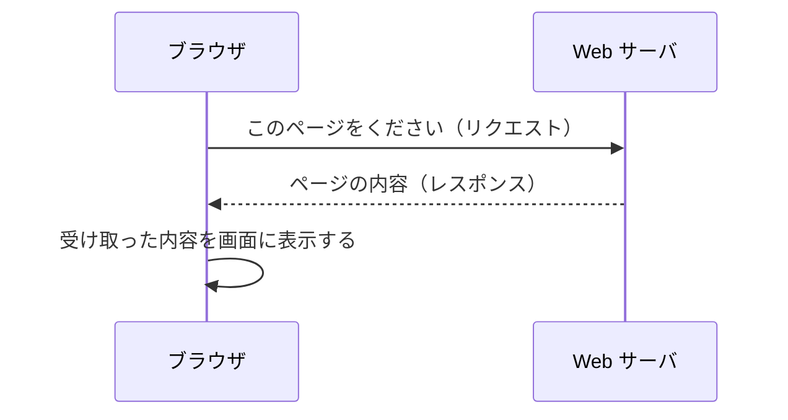

# Web サーバとは何か

> 疑問: Web サーバとは何をするものか。
>
> 答え: ネットワーク越しにリクエストを待ち受け、要求された内容をレスポンスとして返すプログラムです。

## ブラウザとの役割分担

ブラウザで Web ページを開くとき、ブラウザと Web サーバは次のようにやり取りします。

| 役割 | 担当 |
|---|---|
| 要求を送り、結果を画面に表示する | ブラウザ（クライアント） |
| 要求を待ち受け、結果を返す | Web サーバ |

要求する側をクライアント、応答する側をサーバと呼びます。

## 返す内容の種類

| 種類 | 内容 | 例 |
|---|---|---|
| 静的コンテンツ | 保存されているファイルをそのまま返す | HTML ファイル、画像 |
| 動的コンテンツ | リクエストに応じてプログラムが内容を作る | 検索結果、ログイン後のページ |

動的コンテンツを Java で作るための仕組みが、後の章で扱う Servlet です。

## 「サーバ」が指すもの

「サーバ」という言葉は、次の2つのどちらも指します。

- プログラム: 要求を待ち受けるソフトウェア（例: Tomcat）
- コンピュータ: そのソフトウェアが動いているマシン

この教材の「Web サーバ」は、基本的にプログラムのことを指します。

---

次: [入力を受けて出力するプログラムとどう違うのか](02-web-server-vs-program.md)
