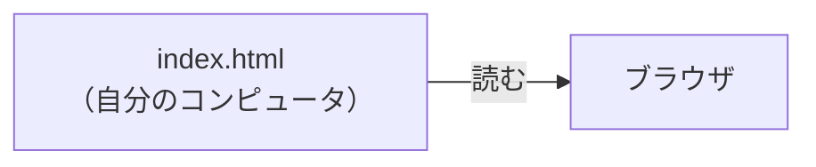
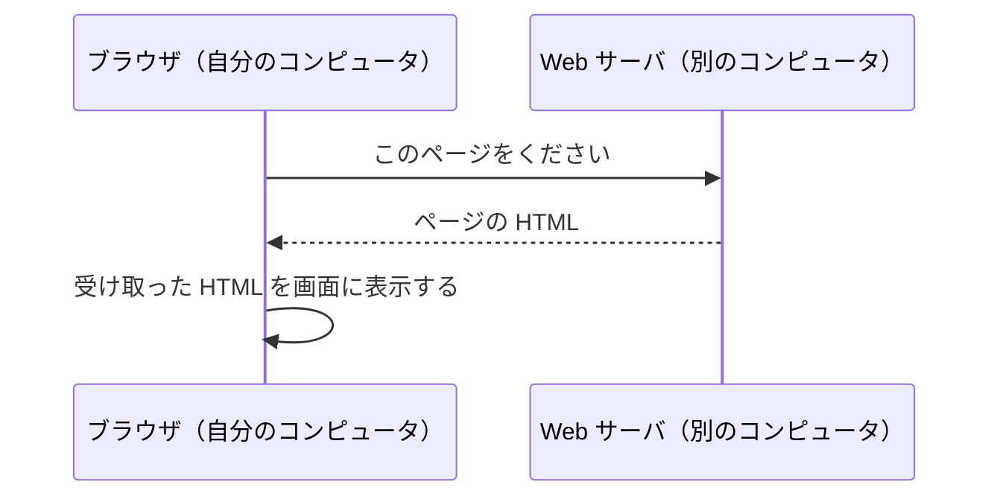
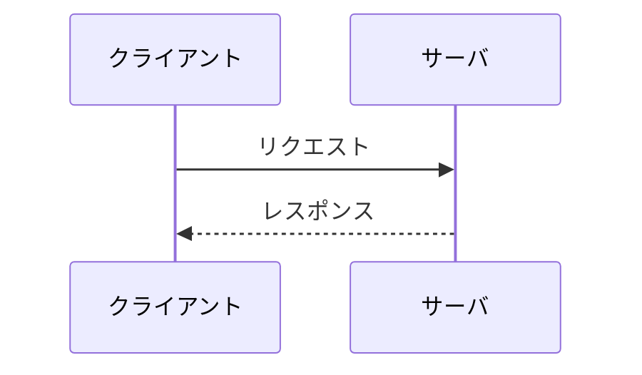

# Web サーバとは何か

> 疑問: ブラウザで見ているページは、どこから来ているのか。
>
> 答え: 別のコンピュータで動いているプログラムが送ってきたものです。このプログラムを Web サーバと呼びます。

## 自分で書いた HTML を開くとき

自分で書いた HTML ファイルは、ブラウザで開くと画面に表示できます。このとき、ブラウザは自分のコンピュータにあるファイルを読んでいます。

## 他の人のページを開くとき

ニュースサイトなどのページの HTML ファイルは、自分のコンピュータにはありません。そのサイトを運営している人のコンピュータにあります。

ブラウザは、そのコンピュータに「このページをください」と頼みます。頼まれたコンピュータでは、あるプログラムが頼みを受け取り、HTML を送り返します。このプログラムが Web サーバです。

## 頼む側と応える側

ここまでのやり取りでは、ブラウザと Web サーバの役割がはっきり分かれていました。

- ブラウザは、ページがほしくなったときに頼む
- Web サーバは、頼まれるのを待っていて、頼まれたら応える

Web サーバのほうから先に話しかけることはありません。やり取りは、いつも頼む側から始まり、応える側が返事をして終わります。

### クライアントとサーバ

頼む側と応える側には、それぞれ次の名前があります。

- クライアント: 頼む側
- サーバ: 頼まれるのを待っていて、頼まれたら応える側

また、2つの間で送られるものにも、名前があります。

- リクエスト: クライアントからサーバへ送る頼み
- レスポンス: サーバからクライアントへ返す返事

他の人のページを開くときは、ブラウザがクライアントで、Web サーバがサーバです。ブラウザが「このページをください」というリクエストを送り、Web サーバがページの HTML をレスポンスとして返します。

## 返すページの作り方

Web サーバが返すページには、いつ開いても同じ中身のページと、開くたびに中身が変わるページがあります。

会社の紹介ページは、だれがいつ開いても同じ中身です。このようなページは、HTML ファイルとして前もって書いておけます。Web サーバは、保存してあるファイルをそのまま返せば済みます。

検索結果のページは、検索した言葉によって中身が変わります。どんな言葉で検索されるかは、前もってわかりません。そのため、ファイルとして書いておけません。Web サーバは、リクエストが来るたびに、プログラムで HTML を作って返します。

### 静的ページと動的ページ

この2種類のページには、次の名前があります。

- 静的ページ: 前もって書いておいた HTML ファイルを、そのまま返すページ
- 動的ページ: リクエストが来るたびに、プログラムが HTML を作って返すページ

会社の紹介ページは静的ページで、検索結果のページは動的ページです。

Servlet は、動的ページを作るプログラムを Java で書くための仕組みです。

## 「サーバ」が指すもの

「サーバ」という言葉は、次の2つのどちらを指すこともあります。

- 頼みに応えるプログラム
- そのプログラムが動いているコンピュータ

どちらを指すかは、話の流れで決まります。「サーバを起動する」と言えばプログラムのことで、「サーバを置く部屋」と言えばコンピュータのことです。

ここでは、「Web サーバ」はプログラムのことを指します。

---

次: [入力を受けて出力するプログラムとどう違うのか](02-web-server-vs-program.md)
