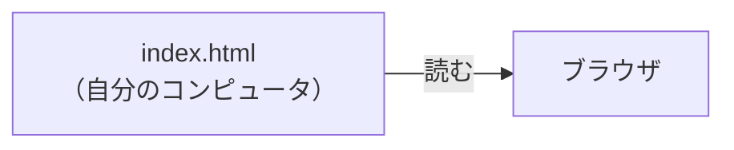
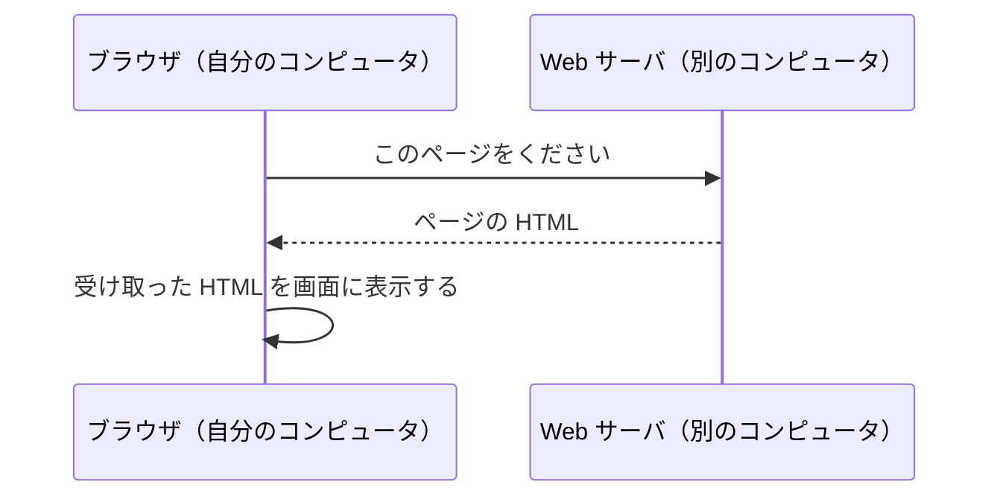

# Web サーバとは何か

> 疑問: ブラウザで見ているページは、どこから来ているのか。
>
> 答え: 別のコンピュータで動いているプログラムが送ってきたものです。このプログラムを Web サーバと呼びます。

## 自分で書いた HTML を開くとき

自分で書いた HTML ファイルは、ブラウザで開くと画面に表示できます。このとき、ブラウザは自分のコンピュータにあるファイルを読んでいます。

## 他の人のページを開くとき

ニュースサイトなどのページの HTML ファイルは、自分のコンピュータにはありません。そのサイトを運営している人のコンピュータにあります。

ブラウザは、そのコンピュータに「このページをください」と頼みます。頼まれたコンピュータでは、あるプログラムが頼みを受け取り、HTML を送り返します。このプログラムが Web サーバです。

## 頼む側と応える側の呼び名

このやり取りに出てくるものには、次の呼び名があります。

- クライアント: 頼む側。ここではブラウザ
- サーバ: 頼みに応える側。ここでは Web サーバ
- リクエスト: クライアントからサーバへの頼み
- レスポンス: サーバからクライアントへの返事

## 返すページの作り方

Web サーバが返すページの作り方は、大きく2つあります。

- 保存してある HTML ファイルを、そのまま返す
- 頼まれるたびに、プログラムが HTML を作って返す

検索結果のページは、検索した言葉によって中身が変わります。このようなページは、前もってファイルとして用意しておけません。そのため、プログラムが頼まれるたびに作ります。

このページを作るプログラムを Java で書く仕組みが、後の章で扱う Servlet です。

## 「サーバ」が指すもの

「サーバ」という言葉は、次の2つのどちらも指します。

- 頼みに応えるプログラム
- そのプログラムが動いているコンピュータ

この教材の「Web サーバ」は、基本的にプログラムのことを指します。

---

次: [入力を受けて出力するプログラムとどう違うのか](02-web-server-vs-program.md)
