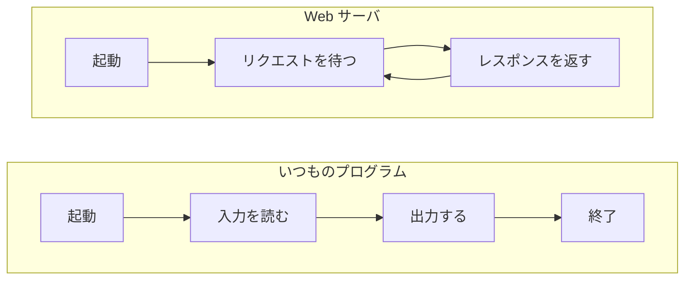

# 入力を受けて出力するプログラムとどう違うのか

> 疑問: Web サーバもリクエストを受けてレスポンスを返すなら、入力を受けて出力するいつものプログラムと同じではないのか。
>
> 答え: 入力を受けて出力するところは同じです。違うのは、終わらずに待ち続けることと、別のコンピュータにいるたくさんの相手に返事をすることです。

## 同じところ

入力を受けて出力するプログラムは、たとえば名前を読み込んで「こんにちは、〇〇さん」と表示します。

Web サーバも、やっていることは同じです。リクエストという入力を受け取り、レスポンスという出力を返します。

## 違い1: 終わらずに待ち続ける

いつものプログラムは、1回入力を受けて出力すると終わります。

Web サーバは、レスポンスを返しても終わりません。いつ次のリクエストが来てもよいように、止められるまで待ち続けます。

## 違い2: 相手が別のコンピュータにいる

いつものプログラムは、自分のコンピュータでキーボードから入力を受け、画面に出力します。

Web サーバは、別のコンピュータのブラウザからリクエストを受け、そのブラウザへレスポンスを送り返します。

## 違い3: 相手がたくさんいる

いつものプログラムの相手は、実行した1人だけです。

Web サーバには、たくさんの人のブラウザから、同時にリクエストが届くことがあります。Web サーバは、それぞれに返事をしなければなりません。

## 違い4: やり取りの形が決まっている

いつものプログラムは、入力と出力の書き方を自分で自由に決められます。使うのは自分だけなので、それで困りません。

Web サーバの相手は、世界中のいろいろなブラウザです。どのブラウザとも話が通じるように、リクエストとレスポンスの形が決められています。この決まりを HTTP と呼びます。HTTP は [HTTP とは何か](04-what-is-http.md) で説明します。

> コラム: 手紙の宛先
>
> 手紙を出すときのことを考えてみてください。封筒のどこに宛先を書くかが人によってばらばらだったら、郵便局は、どこを読めば届け先がわかるのかに困ってしまいます。封筒の表に郵便番号と宛先を書く、という決まりがあるから、どの郵便局でも手紙を届けられます。
>
> Web サーバも同じです。もしブラウザごとに頼み方がばらばらだったら、Web サーバはすべてのブラウザの頼み方を知っておかなければなりません。形が決まっているから、Web サーバはどのブラウザのリクエストでも読み取ることができるのです。

## 違いから生まれる手間

Web サーバを作るには、ページを作る処理の他に、次のことも書く必要があります。

- 別のコンピュータからのリクエストを待ち続ける
- 決まった書き方のリクエストを読み取り、決まった書き方でレスポンスを書く
- たくさんのリクエストに、同時に返事をする

これらは、どの Web サーバでも同じように処理を実装しなければいけません。毎回自分で書くのは大変なので、この部分を引き受けてくれるプログラムがあります。それが、後の章で扱う Tomcat です。

---

前: [Web サーバとは何か](01-what-is-web-server.md) ｜ 次: [URL とは何か](03-what-is-url.md)
