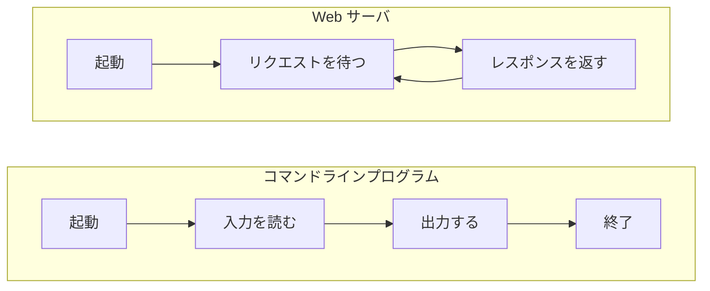

# 入力を受けて出力するプログラムとどう違うのか

> 疑問: Web サーバも入力を受けて出力するなら、普通のプログラムと何が違うのか。
>
> 答え: 入力から出力へという基本は同じです。違いは、起動したまま待ち続け、ネットワーク越しに複数の相手へ決まった形式で応答し続けることです。

## 動き方の違い

コマンドラインプログラムは、1回の入力を処理すると終了します。Web サーバは、終了せずに次のリクエストを待ちます。

## 比較

| 観点 | コマンドラインプログラム | Web サーバ |
|---|---|---|
| 動作期間 | 処理が終わると終了する | 停止されるまで動き続ける |
| 入力 | コマンド引数や標準入力 | ネットワークから届くリクエスト |
| 出力 | 標準出力やファイル | ネットワークへ返すレスポンス |
| 相手 | 通常は実行した人やプログラム | ネットワーク上の複数のクライアント |
| 同時処理 | 通常は考えなくてよい | 複数のリクエストを同時に処理する |
| 入出力の形式 | プログラムごとに自由 | HTTP という共通の形式に従う |

## 違いから生まれる課題

Web サーバを作るには、アプリの処理の他に次のことも必要です。

- ネットワーク接続を待ち受ける
- 決まった形式でリクエストを解析し、レスポンスを組み立てる
- 複数のリクエストを同時に処理する

これらはどの Web アプリでも共通なので、毎回自分で書くのは非効率です。この共通部分を引き受けるのが、後の章で扱う Tomcat です。

---

前: [Web サーバとは何か](01-what-is-web-server.md) ｜ 次: [URL とは何か](03-what-is-url.md)
