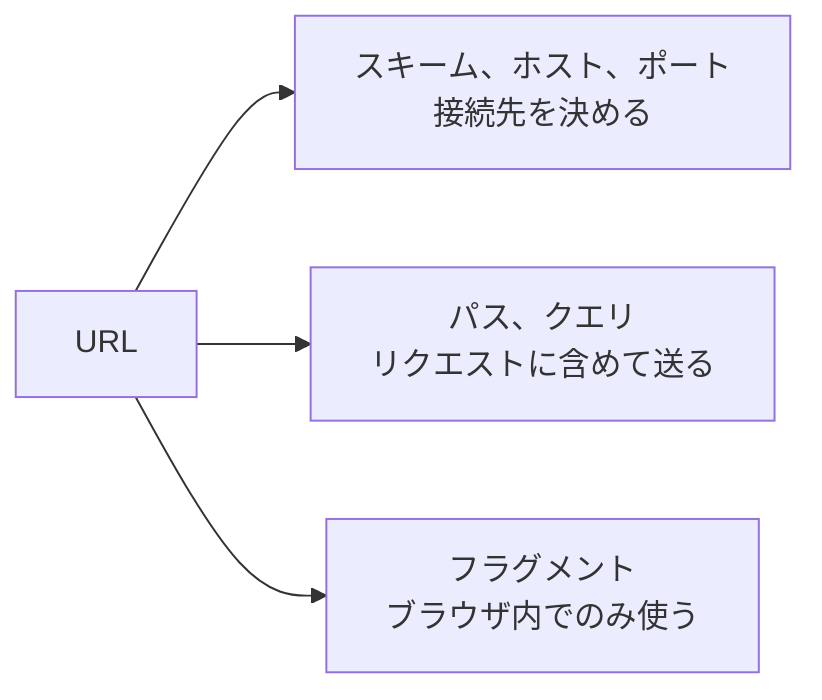

# URL とは何か

> 疑問: URL とは何か。
>
> 答え: Web 上のリソースの場所と、そこへのアクセス方法を表す文字列です。

リソースとは、HTML ページ、画像、検索結果など、URL で指し示せる対象のことです。

## URL の構成

```text
http://example.com:8080/myapp/hello?name=taro#greeting
└─┬┘   └────┬────┘ └┬─┘└─────┬───┘ └───┬───┘ └───┬──┘
スキーム  ホスト   ポート   パス      クエリ    フラグメント
```

| 要素 | 例 | 意味 |
|---|---|---|
| スキーム | `http` | アクセス方法 |
| ホスト | `example.com` | サーバの場所 |
| ポート | `8080` | サーバ上の接続先の番号。省略すると `http` は 80、`https` は 443 |
| パス | `/myapp/hello` | サーバ内のリソースの位置 |
| クエリ | `name=taro` | サーバへ渡す追加の値 |
| フラグメント | `greeting` | ページ内の位置 |

クエリは `?` の後に `名前=値` の形で書き、複数ある場合は `a=1&b=2` のように `&` でつなぎます。

## サーバに届く部分

ブラウザは、スキーム、ホスト、ポートをもとに接続先を決め、パスとクエリをリクエストに含めます。フラグメントはブラウザ内で使うものなので、サーバには送られません。



## 使える文字

URL に日本語などをそのまま含めることはできず、`%` と16進数で表現します（パーセントエンコーディング）。たとえば、UTF-8 の `太郎` は `%E5%A4%AA%E9%83%8E` になります。ブラウザのアドレス欄には日本語で表示されることがありますが、送信時には変換されています。

---

前: [入力を受けて出力するプログラムとどう違うのか](02-web-server-vs-program.md) ｜ 次: [HTTP とは何か](04-what-is-http.md)
