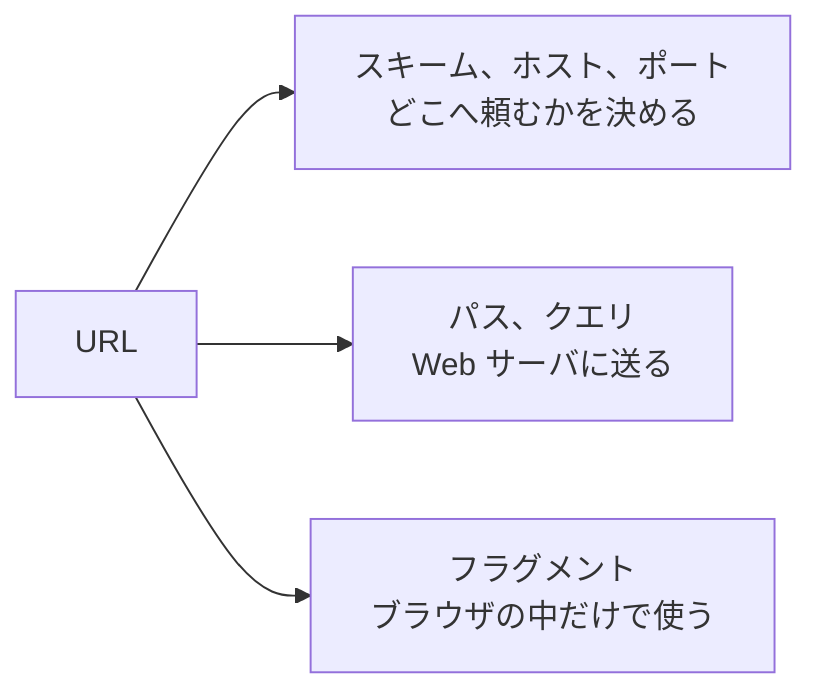

# URL とは何か

> 疑問: ブラウザは、どのコンピュータに、どのページを頼めばよいかを、どうやって知るのか。
>
> 答え: URL に書いてあります。URL は、ページがどのコンピュータのどこにあるかを表す文字列です。

## ファイルの場所とページの場所

自分のコンピュータのファイルを開くときは、`/home/taro/index.html` のような場所を指定します。この場所を見れば、どのフォルダのどのファイルかがわかります。

他のコンピュータにあるページを頼むときは、それに加えて、どのコンピュータに頼むかも必要です。この2つをまとめて1つの文字列にしたものが URL です。

```text
https://example.com/news/today.html
        └────┬────┘ └──────┬──────┘
     どのコンピュータか   その中のどのページか
```

## URL を部品に分ける

URL は、もう少し細かい部品に分かれています。

```text
http://example.com:8080/myapp/hello?name=taro#greeting
└─┬┘   └────┬────┘ └┬─┘└─────┬───┘ └───┬───┘ └───┬──┘
スキーム  ホスト   ポート   パス      クエリ    フラグメント
```

それぞれの部品は、次のことを表します。

- スキーム: やり取りの書き方。`http` か、通信を暗号化する `https` を使う
- ホスト: どのコンピュータに頼むか
- ポート: そのコンピュータの中の、どのプログラムに頼むか
- パス: そのプログラムに、どのページを頼むか
- クエリ: ページを作るときに使ってほしい値
- フラグメント: ページの中のどの位置を表示するか

## ポート: コンピュータの中の窓口

1台のコンピュータでは、いくつものプログラムが同時に動いています。ポートは、その中から頼む相手のプログラムを選ぶための番号です。建物の住所がホストで、部屋番号がポートだと考えるとわかりやすくなります。

ポートは省略できます。省略すると、`http` では 80 番、`https` では 443 番を使います。普段見る URL にポートが書かれていないのは、このためです。

## クエリ: ページに値を渡す

検索サイトで「猫」と検索すると、URL は `https://example.com/search?q=猫` のようになります。

`?` の後ろがクエリです。`名前=値` の形で、Web サーバに値を渡します。値が2つ以上あるときは、`a=1&b=2` のように `&` でつなぎます。

Web サーバのプログラムは、この値を見て「猫」の検索結果のページを作ります。

## Web サーバに届く部分

URL の部品は、すべてが Web サーバに届くわけではありません。

- スキーム、ホスト、ポート: ブラウザが、どこへ頼むかを決めるのに使う
- パス、クエリ: リクエストに入れて、Web サーバに送る
- フラグメント: ブラウザが、表示する位置を決めるのに使う。Web サーバには送らない



Web サーバのプログラムが受け取るのは、パスとクエリです。後の章で Servlet を書くときも、この2つを使います。

## URL に日本語を書くとき

URL には、日本語をそのまま入れられません。日本語は `%` と英数字の組み合わせに置き換えて送ります。たとえば `太郎` は `%E5%A4%AA%E9%83%8E` になります。

ブラウザのアドレス欄では日本語で見えることがありますが、送るときにはブラウザが置き換えています。

---

前: [入力を受けて出力するプログラムとどう違うのか](02-web-server-vs-program.md) ｜ 次: [HTTP とは何か](04-what-is-http.md)
