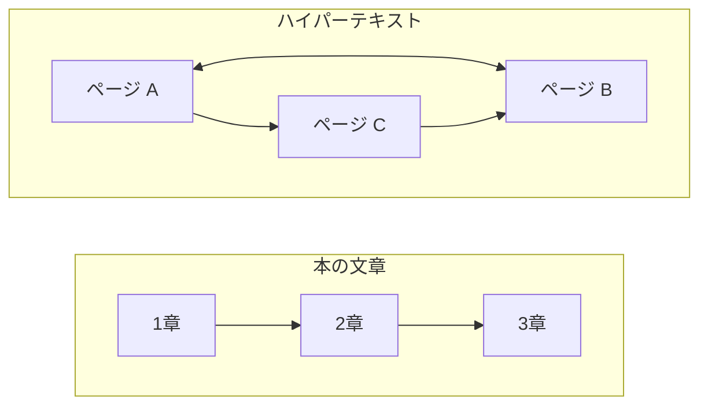

# 補遺: ハイパーテキストとは何か

> 疑問: HTML や HTTP の「HT」はハイパーテキストの略だが、ハイパーテキストとは何か。
>
> 答え: リンクで他の文書へ移動できる文章のことです。

## 本の文章とリンクのある文章

本の文章は、ふつう先頭から順に読みます。1章の次は2章、2章の次は3章です。

Web のページには、リンクがあります。リンクをクリックすると、別のページへ移動できます。どのリンクをたどるかは読む人が選ぶので、読む順番は人によって変わります。

このように、リンクで他の文書とつながっている文章をハイパーテキストと呼びます。



## HTML でリンクを書く

HTML では、`<a>` タグでリンクを書きます。

```html
<a href="https://example.com/next.html">次のページ</a>
```

`href` に、移動先のページの URL を書きます。リンク先は、別のコンピュータにあるページでもかまいません。URL にはホストが入っているので、どのコンピュータのページでも指せます。

## 名前に入っている「ハイパーテキスト」

HTML と HTTP は、どちらも名前にハイパーテキストが入っています。

- HTML（HyperText Markup Language）: ハイパーテキストを書くための言語
- HTTP（HyperText Transfer Protocol）: ハイパーテキストを送り届けるための決まり

今の HTTP は、HTML だけでなく、画像などいろいろなデータを送るのにも使われています。何のデータかは、[HTTP とは何か](04-what-is-http.md) で見た `Content-Type` ヘッダーで伝えます。

> コラム: リンクが世界をつないだ
>
> ハイパーテキストという考え方は、Web より前からありました。ただ、それまでのリンクは、1台のコンピュータや1つのシステムの中でしか使えませんでした。
>
> 1990年ごろ、URL と HTTP と HTML を組み合わせた仕組みが作られました。URL で「どのコンピュータの、どのページか」を指せるので、世界中のコンピュータにある文書を、リンクで1つにつなげられるようになりました。これが World Wide Web です。Web は「蜘蛛の巣」という意味で、文書が網の目のようにつながった姿から名付けられました。
>
> この仕組みによって、世界は次のように変わりました。
>
> - 自分のコンピュータにページを置けば、世界中の人に読んでもらえるようになった
> - 他の人のページへのリンクは、相手に断らずに張れる。全体をまとめる管理者がいないまま、網が広がっていった
> - 全体の目次を持つ人がいないので、リンクをたどってページを集める検索エンジンが生まれた
>
> 参考: [World Wide Web（Wikipedia）](https://ja.wikipedia.org/wiki/World_Wide_Web)

---

前: [HTTP とは何か](04-what-is-http.md) ｜ 次: [URI とは何か](appendix-b-uri.md)
