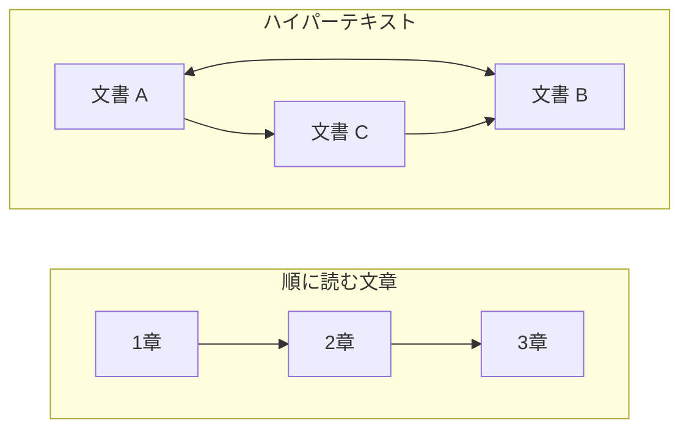

# 補遺: ハイパーテキストとは何か

> 疑問: HTTP や HTML の「ハイパーテキスト」とは何か。
>
> 答え: リンクによって他の文書や場所へ移動できるテキストのことです。

## 通常の文章との違い

本のような文章は、基本的に先頭から順に読みます。ハイパーテキストでは、リンクをたどって読む順番を選べます。



## 名前に含まれる「ハイパーテキスト」

| 用語 | 正式名称 | 意味 |
|---|---|---|
| HTML | HyperText Markup Language | ハイパーテキストを記述する言語 |
| HTTP | HyperText Transfer Protocol | ハイパーテキストを転送する通信の決まり |

HTML では `<a>` タグでリンクを書きます。

```html
<a href="https://example.com/next.html">次のページ</a>
```

現在の HTTP は、HTML だけでなく画像や JSON など、さまざまなデータの転送に使われています。

---

前: [HTTP とは何か](04-what-is-http.md) ｜ 次: [URI とは何か](appendix-b-uri.md)
