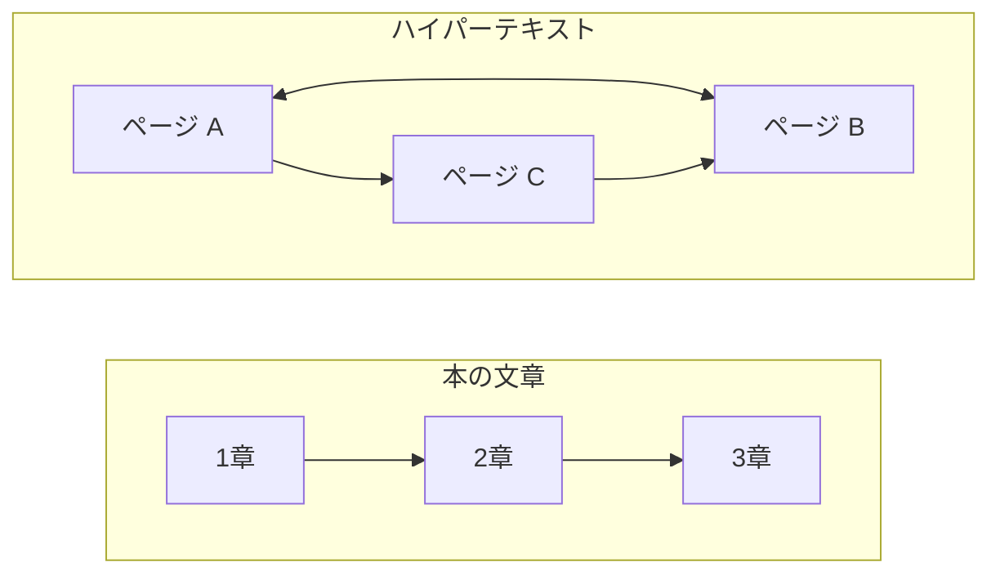

# 補遺: ハイパーテキストとは何か

> 疑問: HTML や HTTP の「HT」はハイパーテキストの略だが、ハイパーテキストとは何か。
>
> 答え: リンクで他の文書へ移動できる文章のことです。

## 本の文章とリンクのある文章

本の文章は、ふつう先頭から順に読みます。1章の次は2章、2章の次は3章です。

Web のページには、リンクがあります。リンクをクリックすると、別のページへ移動できます。どのリンクをたどるかは読む人が選ぶので、読む順番は人によって変わります。

このように、リンクで他の文書とつながっている文章をハイパーテキストと呼びます。



## HTML でリンクを書く

HTML では、`<a>` タグでリンクを書きます。

```html
<a href="https://example.com/next.html">次のページ</a>
```

`href` に、移動先のページの URL を書きます。リンク先は、別のコンピュータにあるページでもかまいません。

## 名前に入っている「ハイパーテキスト」

HTML と HTTP は、どちらも名前にハイパーテキストが入っています。

- HTML（HyperText Markup Language）: ハイパーテキストを書くための言語
- HTTP（HyperText Transfer Protocol）: ハイパーテキストを送り届けるための決まり

今の HTTP は、HTML だけでなく、画像などいろいろなデータを送るのにも使われています。

---

前: [HTTP とは何か](04-what-is-http.md) ｜ 次: [URI とは何か](appendix-b-uri.md)
