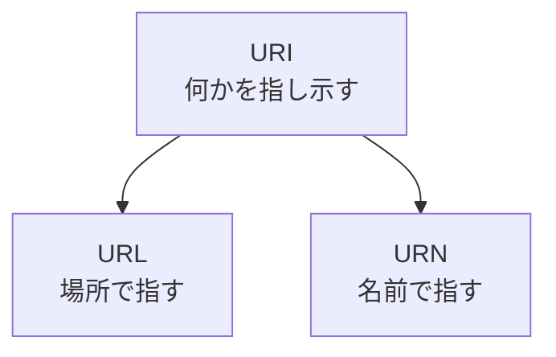

# 補遺: URI とは何か

> 疑問: URL と似た「URI」という言葉を見かけた。URL とは何が違うのか。
>
> 答え: URI は、何かを指し示す文字列をまとめた呼び名です。URL は、その中でも場所を使って指し示すものです。

## 場所で指すか、名前で指すか

ある本を指し示すには、2つの方法があります。

- 場所で指す: 「〇〇図書館の3階の、この棚にある本」
- 名前で指す: 「ISBN が 978-4-00-000000-0 の本」

Web のページを場所で指す文字列が URL です。名前で指す文字列は URN と呼びます。URI は、URL と URN の両方をまとめた呼び名です。

名前で指す URN だけでは、どこにあるかはわかりません。そのため、ブラウザでページを開くときに使うのは URL です。

## この教材での使い分け

Web のページを指すときは、この教材では「URL」と呼びます。

ただし、後の章で書く Servlet には、名前に URI と URL が入った次のメソッドがあります。`https://example.com/myapp/hello?name=taro` を開いたとき、それぞれ次の文字列を返します。

- `getRequestURL()`: `https://example.com/myapp/hello`
- `getRequestURI()`: `/myapp/hello`

名前の違いは、返す範囲の違いだと覚えておけば十分です。どちらも `?` から後ろのクエリは返しません。

---

前: [ハイパーテキストとは何か](appendix-a-hypertext.md) ｜ 次: [Java で Web サーバを作るにはどうするのか](../02-servlet-and-tomcat/01-java-web-server.md)
