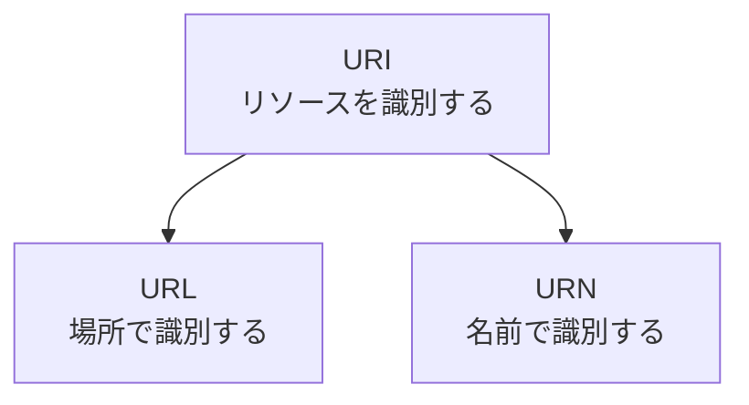

# 補遺: URI とは何か

> 疑問: URI とは何か。URL とどう違うのか。
>
> 答え: URI はリソースを識別する文字列の総称です。URL は URI のうち、リソースの場所によって識別するものです。

## URI と URL の関係

| 種類 | 例 | 識別の方法 |
|---|---|---|
| URL | `https://example.com/index.html` | どこにあるか |
| URN | `urn:isbn:9784000000000` | 何という名前か |

URN の例は ISBN を使った形式を示すためのものです。URN は名前を示すだけなので、それだけではアクセス先がわかりません。

## 使い分け

Web ページの場所を指して話すなら、「URL」で問題ありません。

Servlet API には次の2つのメソッドがあり、名前と戻り値の範囲が異なります。`https://example.com/myapp/hello?name=taro` にアクセスした場合の値は次の通りです。

| メソッド | 戻り値 |
|---|---|
| `req.getRequestURL()` | `https://example.com/myapp/hello` |
| `req.getRequestURI()` | `/myapp/hello` |

どちらもクエリは含みません。クエリは `req.getQueryString()` で取得します。

---

前: [ハイパーテキストとは何か](appendix-a-hypertext.md) ｜ 次: [Java で Web サーバを作るにはどうするのか](../02-servlet-and-tomcat/01-java-web-server.md)
