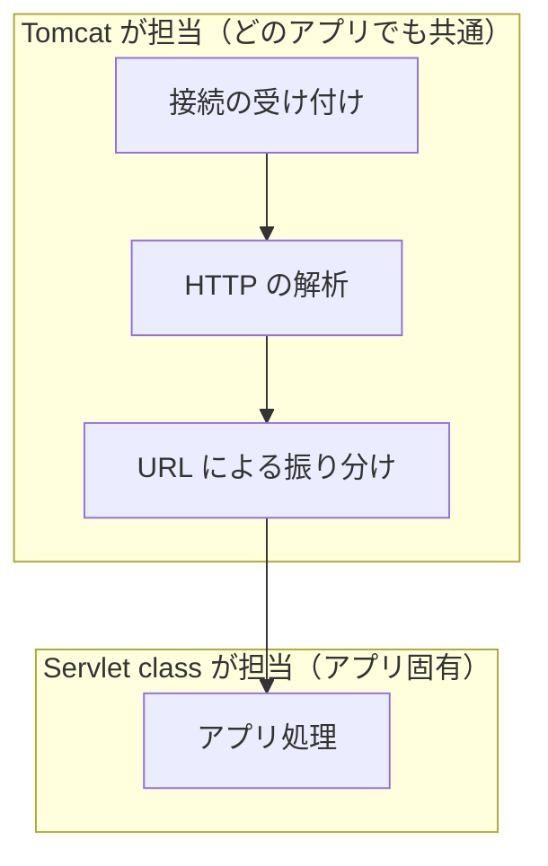

# Java で Web サーバを作るにはどうするのか

> 疑問: Java で Web サーバを作るにはどうすればよいのか。
>
> 答え: 通信から自分で書くこともできますが、通常は Tomcat に通信や HTTP の処理を任せ、自分は Servlet class にアプリ処理だけを書きます。

## すべて自分で書く場合

`ServerSocket` を使うと、Java の標準機能だけで HTTP レスポンスを返せます。

```java
public class RawServer {
    public static void main(String[] args) throws IOException {
        try (ServerSocket server = new ServerSocket(8080)) {
            while (true) {                                // 接続を待ち続ける
                try (Socket socket = server.accept()) {
                    BufferedReader in = new BufferedReader(
                            new InputStreamReader(socket.getInputStream(), StandardCharsets.UTF_8));
                    String requestLine = in.readLine();   // 例: GET /hello HTTP/1.1
                    System.out.println(requestLine);

                    byte[] body = "こんにちは".getBytes(StandardCharsets.UTF_8);
                    OutputStream out = socket.getOutputStream();
                    out.write(("HTTP/1.1 200 OK\r\n"
                            + "Content-Type: text/plain; charset=UTF-8\r\n"
                            + "Content-Length: " + body.length + "\r\n"
                            + "Connection: close\r\n"
                            + "\r\n").getBytes(StandardCharsets.UTF_8));
                    out.write(body);
                    out.flush();
                }
            }
        }
    }
}
```

これは学習用の最小例です。実際に使うには、さらに次のような処理が必要です。

- リクエスト全体の解析（メソッド、パス、クエリ、ヘッダー、ボディ、文字コード）
- URL に応じた処理の振り分け
- 複数のリクエストの同時処理
- セッション管理、不正なリクエストへの対応、タイムアウト

この例では、アプリの処理は `"こんにちは"` を返す部分だけです。残りはどの Web アプリでも共通です。

## 共通部分と固有の部分を分ける



この分担により、開発者はアプリの処理に集中できます。

## 補足: 組み込み Tomcat

Tomcat は通常、独立したサーバとして起動し、その上にアプリを配置します。一方、アプリの中に Tomcat を組み込む方法もあり、Spring Boot はこの構成を標準としています。この教材では、独立した Tomcat を前提にします。

---

前: [URI とは何か](../01-web-basics/appendix-b-uri.md) ｜ 次: [Servlet とは何か](02-what-is-servlet.md)
