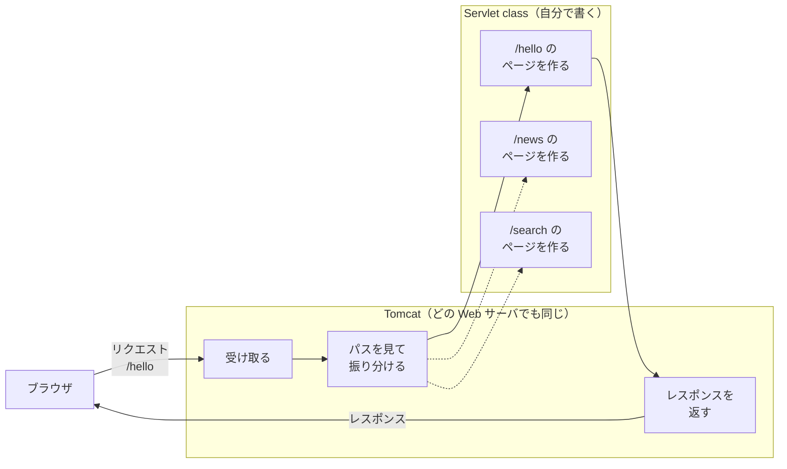

# Java で Web サーバを作るにはどうするのか

> 疑問: Java で Web サーバを作るには、どんなプログラムを書けばよいのか。
>
> 答え: 全部を自分で書くこともできますが、とても大変です。ふつうは、どの Web サーバでも同じ部分を Tomcat に任せ、自分はページを作る部分だけを書きます。

## 全部を自分で書くと

Java の標準機能だけでも、Web サーバは書けます。次のプログラムは、どんなリクエストにも「こんにちは」と返します。

```java
public class RawServer {
    public static void main(String[] args) throws IOException {
        try (ServerSocket server = new ServerSocket(8080)) {
            while (true) {                                // リクエストを待ち続ける
                try (Socket socket = server.accept()) {
                    BufferedReader in = new BufferedReader(
                            new InputStreamReader(socket.getInputStream(), StandardCharsets.UTF_8));
                    String requestLine = in.readLine();   // 例: GET /hello HTTP/1.1
                    System.out.println(requestLine);

                    byte[] body = "こんにちは".getBytes(StandardCharsets.UTF_8);
                    OutputStream out = socket.getOutputStream();
                    out.write(("HTTP/1.1 200 OK\r\n"
                            + "Content-Type: text/plain; charset=UTF-8\r\n"
                            + "Content-Length: " + body.length + "\r\n"
                            + "Connection: close\r\n"
                            + "\r\n").getBytes(StandardCharsets.UTF_8));
                    out.write(body);
                    out.flush();
                }
            }
        }
    }
}
```

1行ずつ理解する必要はありません。見てほしいのは、次の2点です。

- `while (true)` で、終わらずにリクエストを待ち続けている
- レスポンスを、HTTP の決まりどおりに文字で組み立てている

## まだ足りないこと

このプログラムは、とても小さな見本です。本物の Web サーバとして使うには、他にも次のことを書く必要があります。

- リクエストの全体を、HTTP の決まりに沿って読み取る
- URL のパスを見て、どのページを作るかを選ぶ
- たくさんのリクエストに、同時に返事をする
- おかしなリクエストが来ても止まらないようにする

この中に、作りたいページに関係するものはありません。どれも、どの Web サーバでも同じように必要になる部分です。

## 同じ部分と、自分で書く部分を分ける

そこで、Web サーバの仕事を2つに分けます。

- どの Web サーバでも同じ部分: Tomcat というプログラムに任せる
- 作りたいページによって変わる部分: 自分で書く。この部分を Servlet class と呼ぶ



パスが `/hello` なので、Tomcat は `/hello` の Servlet class を選びます。点線の Servlet class は、別のパスのリクエストが来たときに選ばれます。

こう分けると、自分で書くのはページを作る部分だけになります。

## 補足: Tomcat の置き方

この教材では、Tomcat を1つのプログラムとして起動し、その上に自分の Servlet class を載せる方法を使います。

自分のプログラムの中に Tomcat を組み込む方法もあります。Spring Boot というフレームワークは、こちらの方法を使っています。

---

前: [URI とは何か](../01-web-basics/appendix-b-uri.md) ｜ 次: [Servlet とは何か](02-what-is-servlet.md)
