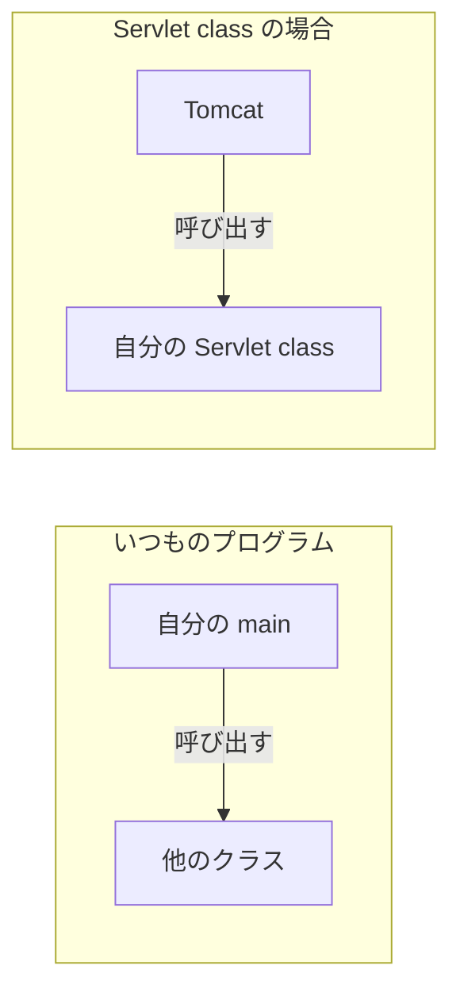

# Servlet とは何か

> 疑問: 自分で書く「ページを作る部分」は、どんなコードになるのか。
>
> 答え: Servlet という決まりに沿った Java のクラスです。リクエストを受け取り、レスポンスを書くメソッドだけを書きます。

## Servlet class の例

次のクラスは、`/hello` を開いたブラウザに「こんにちは」と返します。

```java
@WebServlet("/hello")
public class HelloServlet extends HttpServlet {
    @Override
    protected void doGet(HttpServletRequest req, HttpServletResponse resp) throws IOException {
        resp.setContentType("text/plain; charset=UTF-8");
        resp.getWriter().println("こんにちは");
    }
}
```

コードの各部分は、次のことを表します。

- `@WebServlet("/hello")`: このクラスが、パス `/hello` のリクエストを受け持つ
- `extends HttpServlet`: Servlet の決まりに沿ったクラスにする
- `doGet`: `GET` のリクエストが来たときに呼ばれるメソッド
- `req`: 届いたリクエスト
- `resp`: これから返すレスポンス。ここに中身を書き込む

前のファイルの `RawServer` と比べてください。リクエストを待つ処理も、HTTP の文字を組み立てる処理もありません。それらは Tomcat が受け持つからです。

## 「Servlet」という言葉が指すもの

「Servlet」という言葉は、場面によって次の3つのどれかを指します。

- **Servlet 仕様**: Tomcat と自分のクラスの間の取り決めを、文章で書いたもの
- **Servlet API**: その取り決めを、Java のクラスやインタフェースとして用意したもの。`HttpServlet` や `HttpServletRequest` など
- **Servlet class*: Servlet API を使って、自分で書くクラス。上の `HelloServlet` など

この教材では、3つを区別するために、上の呼び名を使い分けます。

## 呼び出すのは Tomcat

いつものプログラムでは、自分の `main` メソッドから、他のクラスのメソッドを呼び出します。

Servlet class には `main` メソッドがありません。`doGet` を呼び出すのは Tomcat です。自分は、呼ばれたときに何をするかだけを書きます。

前のページの図では、Tomcat がパスを見て `/hello` の Servlet class を選んでいました。選んだあとに Tomcat が呼び出すのが、この `doGet` です。



## Servlet API はどこにあるのか

Servlet class をコンパイルするには、`HttpServlet` などの Servlet API が必要です。

Servlet API は、JDK（Java をインストールすると付いてくる部分）には入っていません。Jakarta EE という、サーバ向けの仕様の集まりに含まれていて、パッケージ名は `jakarta.servlet` です。そのため、Maven や Gradle などのビルドツール（ライブラリを取ってきて、コンパイルをまとめて行う道具）で、外のライブラリとして依存関係に入れます。

次は、Maven を使う場合の `pom.xml` の例です。

```xml
<dependency>
    <groupId>jakarta.servlet</groupId>
    <artifactId>jakarta.servlet-api</artifactId>
    <version>6.1.0</version>
    <scope>provided</scope>
</dependency>
```

一方で、動かすときには、Tomcat が持っている Servlet API が使われます。Servlet API は Tomcat と Servlet class の間の取り決めなので、Tomcat に同梱されています。そのため、アプリを1つのファイル（war）にまとめるときに、Servlet API を入れる必要はありません。

上の例の `<scope>provided</scope>` は、この指定です。コンパイルのときは Servlet API を使い、war には入れません。

> コラム: パッケージ名が変わった理由
>
> 古い資料では、Servlet API のパッケージ名が `javax.servlet` になっています。今は `jakarta.servlet` です。
>
> Servlet は、もともと Java EE という、サーバ向けの Java の仕様の一部でした。Java EE は Oracle という会社が管理していましたが、2017年に、Eclipse 財団という団体へ引き渡されることになりました。その後の話し合いで、「Java」という名前と `javax` というパッケージ名は、引き続き Oracle のものとされました。そのため、仕様の名前は Jakarta EE に、パッケージ名は `jakarta` に変わりました。
>
> Tomcat は、10 から `jakarta.servlet` を使っています。この教材は Tomcat 11 を使うので、古い資料のコードを動かすときは、パッケージ名を書き換える必要があります。
>
> 参考: [Jakarta EE（Wikipedia）](https://ja.wikipedia.org/wiki/Jakarta_EE)

---

前: [Java で Web サーバを作るにはどうするのか](01-java-web-server.md) ｜ 次: [Tomcat とは何か](03-what-is-tomcat.md)
