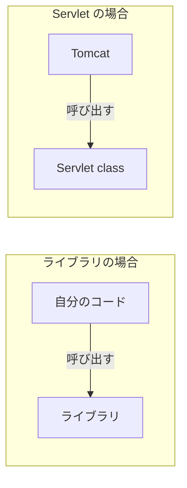

# Servlet とは何か

> 疑問: Servlet とは何か。
>
> 答え: Java で HTTP リクエストを処理してレスポンスを返すための仕組みです。この言葉は、仕様、API、自分で書くクラスのどれを指す場合もあります。

## 「Servlet」が指す3つのもの

| 呼び方 | 指すもの | 例 |
|---|---|---|
| Servlet 仕様 | コンテナとアプリの間の取り決め | Jakarta Servlet 6.1 |
| Servlet API | 仕様を Java の型として定義したもの | `HttpServlet`、`HttpServletRequest` |
| Servlet class | Servlet API に沿って自分で書くクラス | `HelloServlet` |

## Servlet class の例

```java
@WebServlet("/hello")
public class HelloServlet extends HttpServlet {
    @Override
    protected void doGet(HttpServletRequest req, HttpServletResponse resp) throws IOException {
        resp.setContentType("text/plain; charset=UTF-8");
        resp.getWriter().println("こんにちは");
    }
}
```

`/hello` への GET リクエストに対して、`こんにちは` を返します。ソケットや HTTP の形式を扱うコードはありません。

## Servlet はフレームワークなのか

呼び出しの主導権がアプリ側にないという点は、フレームワークに似ています。



ただし、Servlet API が提供するのは、HTTP を扱うための基本機能（リクエストとレスポンス、セッション、フィルターなど）が中心です。JSON の変換や DB へのアクセスなどは含まれません。

## `jakarta.servlet-api` は実装ではない

Servlet class をコンパイルするには、`jakarta.servlet-api` を依存関係に追加します。

```xml
<dependency>
    <groupId>jakarta.servlet</groupId>
    <artifactId>jakarta.servlet-api</artifactId>
    <version>6.1.0</version>
    <scope>provided</scope>
</dependency>
```

このライブラリが提供するのは主に型の定義です。`HttpServletRequest` などの実体は Tomcat が提供するので、実行時には Tomcat のものが使われます。`provided` は「コンパイル時に使うが、実行環境が提供するので WAR に含めない」という指定です。

## パッケージ名の注意

| Tomcat のバージョン | パッケージ名 |
|---|---|
| 9 まで | `javax.servlet` |
| 10 以降 | `jakarta.servlet` |

古い資料のコードを Tomcat 10 以降で動かすには、基本的にパッケージ名の移行が必要です。

---

前: [Java で Web サーバを作るにはどうするのか](01-java-web-server.md) ｜ 次: [Tomcat とは何か](03-what-is-tomcat.md)
