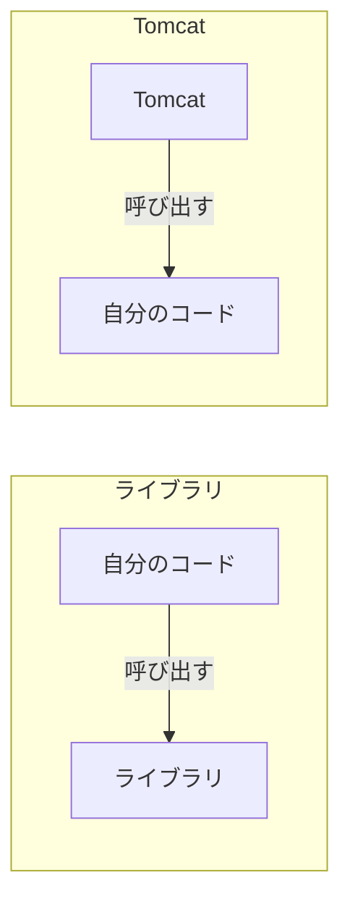

# Tomcat とは何か

> 疑問: Tomcat とは何か。
>
> 答え: Servlet 仕様を実装した実行環境（サーブレットコンテナ）です。HTTP の処理を行い、Servlet class を呼び出します。

## Tomcat が担当すること

| 担当 | 内容 |
|---|---|
| 通信 | 接続を受け付け、HTTP を解析し、レスポンスを送信する |
| 振り分け | URL に対応する Servlet class を呼び出す |
| ライフサイクル管理 | Servlet class の生成、初期化、破棄を行う |
| スレッド管理 | スレッドプールでリクエストを並行処理する |

Servlet class には `main` メソッドがなく、単体では動きません。Tomcat の上に載せて動かします。

## 依存関係に入れるだけでは動かない

通常のライブラリと Tomcat では、呼び出しの向きが逆です。



そのため、Tomcat を別途インストールして起動し、その上にアプリを配置します。

## アプリの配置

アプリは WAR ファイルにまとめて、Tomcat の `webapps/` に置きます。

```text
Tomcat
└─ webapps/
   └─ myapp.war    ← Servlet class や JSP が入っている
```

WAR のファイル名は URL の先頭に使われます。`myapp.war` の中の `/hello` は `/myapp/hello` でアクセスします。この `/myapp` をコンテキストパスと呼びます。

## 他の実装

Servlet 仕様に沿ったコンテナは、Tomcat の他に Jetty や Undertow などがあります。Servlet class は仕様に沿っているので、基本的には他のコンテナでも動きます。

---

前: [Servlet とは何か](02-what-is-servlet.md) ｜ 次: [仕様、API、Servlet class、Tomcat はどう関係するのか](04-relationships.md)
