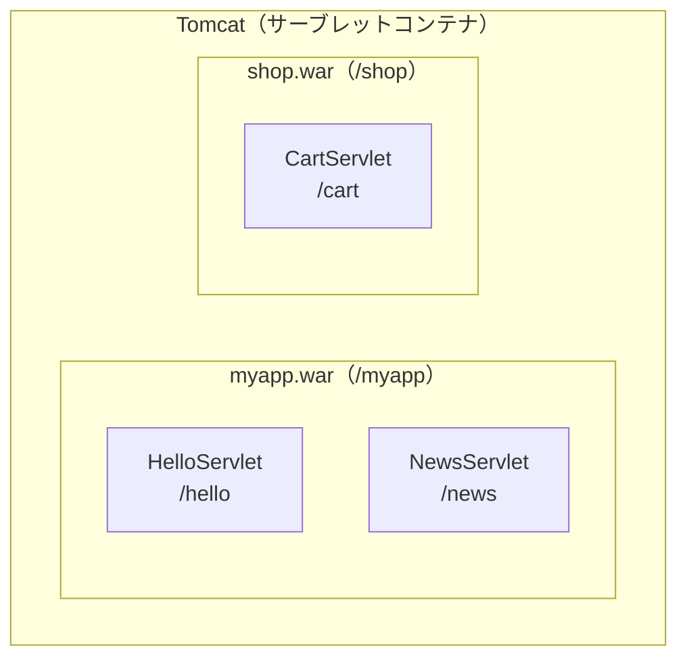

# Tomcat とは何か

> 疑問: Servlet class には `main` メソッドがない。では、どうやって動かすのか。
>
> 答え: Tomcat というプログラムを起動し、その上に Servlet class を載せます。Tomcat がリクエストを受け取り、Servlet class を呼び出します。

## Tomcat が受け持つこと

Tomcat は、Web サーバのうち、どのアプリでも同じ部分を受け持つプログラムです。

- リクエストを待ち、HTTP の決まりに沿って読み取る
- パスを見て、どの Servlet class を呼ぶかを選ぶ
- Servlet class のオブジェクトを作り、メソッドを呼ぶ
- たくさんのリクエストに、同時に返事をする
- Servlet class が書いたレスポンスを、ブラウザに送る

このように Servlet class を載せて動かすプログラムを、サーブレットコンテナと呼びます。

## ライブラリとの違い

前のページでは、Servlet API を外のライブラリとして依存関係に入れました。Tomcat も Servlet に関係するプログラムですが、同じようにライブラリとして入れるわけではありません。

- Servlet API: ライブラリとして入れる。自分のコードから使う
- Tomcat: ライブラリとしては入れない。Tomcat が自分のコードを呼び出す

Tomcat は、自分のコードに呼び出される側ではなく、自分のコードを呼び出す側です。そのため、自分のプロジェクトに入れるだけでは動きません。Tomcat を別に用意して起動し、その上に自分のアプリを載せます。

## アプリを載せる

自分のアプリは、1つのファイルにまとめます。前のページで出てきた、アプリをまとめた1つのファイル（war）です。このファイルを WAR ファイルと呼びます。WAR ファイルの中には、Servlet class などが入っています。

この WAR ファイルを、Tomcat の `webapps/` フォルダに置きます。

```text
Tomcat
└─ webapps/
   └─ myapp.war    ← 自分の Servlet class が入っている
```

Tomcat は起動すると、`webapps/` にある WAR ファイルを読み込み、中の Servlet class を載せた状態になります。1つの Tomcat には、いくつものアプリを載せられます。



## WAR ファイルの名前と URL

WAR ファイルの名前は、URL のパスの最初の部分になります。

`myapp.war` の中に `/hello` を受け持つ Servlet class があるとき、URL は次のようになります。

```text
http://localhost:8080/myapp/hello
                     └─┬──┘└──┬─┘
              WAR ファイルの名前  Servlet class が受け持つパス
```

この `/myapp` の部分を、コンテキストパスと呼びます。1つの Tomcat に複数のアプリを載せても、コンテキストパスで区別できます。

URL の `localhost` は「自分のコンピュータ」を表すホスト名です。自分のコンピュータで Tomcat を動かすときに使います。`8080` は、Tomcat がデフォルトで使うポート番号です。

## Tomcat の仲間

サーブレットコンテナは Tomcat だけではありません。Jetty などもあります。どれも同じ Servlet 仕様に沿っているので、Servlet class は基本的にどれの上でも動きます。

---

前: [Servlet とは何か](02-what-is-servlet.md) ｜ 次: [仕様、API、Servlet class、Tomcat はどう関係するのか](04-relationships.md)
