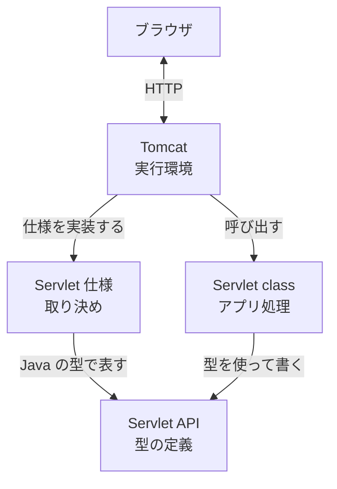
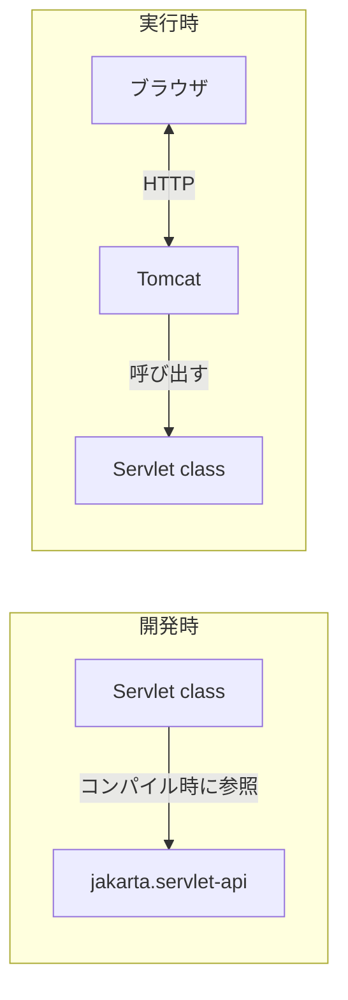

# 仕様、API、Servlet class、Tomcat はどう関係するのか

> 疑問: Servlet に関わる要素はどのように関係するのか。
>
> 答え: Tomcat と Servlet class は、Servlet 仕様という同じ取り決めに従うことで連携します。Servlet API は、その取り決めを Java の型として表したものです。

## 関係図

## それぞれの関係

| 関係 | 内容 |
|---|---|
| Servlet API → Servlet 仕様 | 仕様を Java の型として表している |
| Tomcat → Servlet 仕様 | 仕様を実装している |
| Servlet class → Servlet API | API の型を使って書かれている |
| Tomcat → Servlet class | 生成して呼び出し、不要になれば破棄する |
| ブラウザ ↔ Tomcat | HTTP で通信する。ブラウザが Servlet class と直接通信することはない |

## 開発時と実行時

Tomcat は Servlet API を `lib/servlet-api.jar` として同梱しています。そのため、実行時に `jakarta.servlet-api` を別途用意する必要はありません。

## 仕様があることの効果

Tomcat は Servlet class の中身を知らなくても呼び出せ、Servlet class は Tomcat の内部を知らなくても動きます。両者は仕様で定められた接点だけでつながっています。

---

前: [Tomcat とは何か](03-what-is-tomcat.md) ｜ 次: [URL と Servlet class をどう対応付けるのか](../03-servlet-invocation/01-url-mapping.md)
