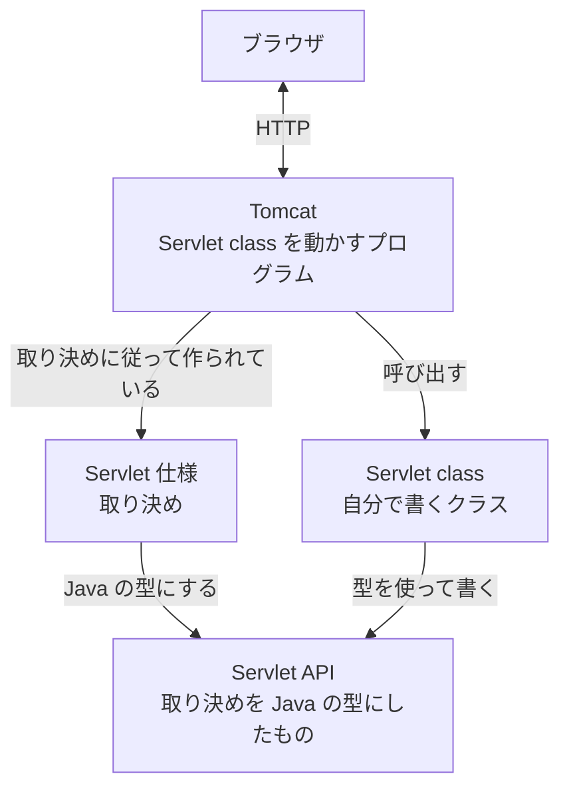
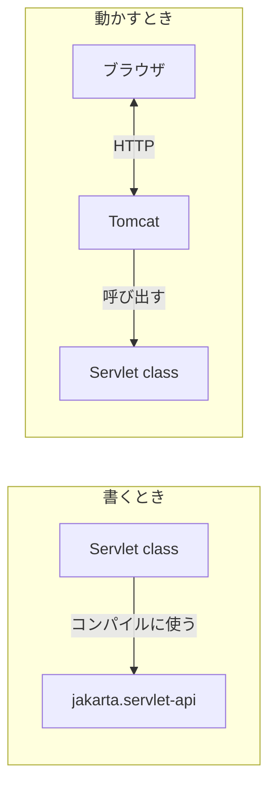

# 仕様、API、Servlet class、Tomcat はどう関係するのか

> 疑問: Tomcat は、自分が書いた Servlet class の中身を知らない。それなのに、なぜ呼び出せるのか。
>
> 答え: Tomcat と Servlet class が、Servlet 仕様という同じ取り決めに従っているからです。Servlet API は、その取り決めを Java の型にしたものです。

## 取り決めがあれば、相手を知らなくてよい

コンセントとプラグを思い浮かべてください。家電を作る人は、どの家のコンセントに挿されるかを知りません。それでも動くのは、コンセントとプラグの形が取り決められているからです。

Tomcat と Servlet class も同じです。

- Tomcat を作った人は、あなたの `HelloServlet` を知らない
- あなたは、Tomcat の中身を知らない
- それでも、両方が Servlet 仕様に従っているので、つながる

## 4つの関係

ここまでに出てきた4つは、次のように関係しています。

図の矢印は、次のことを表します。

- Servlet API は、Servlet 仕様を Java の型にしたもの
- Tomcat は、Servlet 仕様に従って作られている
- Servlet class は、Servlet API の型を使って書く
- Tomcat は、Servlet class を呼び出す
- ブラウザがやり取りする相手は Tomcat。ブラウザが Servlet class と直接やり取りすることはない

## 書くときと動かすとき

Servlet API は、書くときと動かすときで、用意する場所が変わります。

- 書くとき: 自分のプロジェクトに `jakarta.servlet-api` を入れて、コンパイルに使う
- 動かすとき: Tomcat が持っている Servlet API が使われる

前のファイルで `provided` を指定したのは、このためです。

---

## 参考文献

この章では、わかりやすさを優先して説明を単純にしています。正確な仕組みや、さらに詳しい内容は次の資料で学べます。

Servlet の仕様と API:

- [Jakarta Servlet 6.1（仕様）](https://jakarta.ee/specifications/servlet/6.1/)
- [Jakarta Servlet 6.1 API ドキュメント](https://jakarta.ee/specifications/servlet/6.1/apidocs/)

Tomcat のドキュメント:

- [Apache Tomcat 11 Documentation](https://tomcat.apache.org/tomcat-11.0-doc/)
- [Application Developer's Guide（Tomcat でアプリを作る手順）](https://tomcat.apache.org/tomcat-11.0-doc/appdev/index.html)
- [Tomcat Web Application Deployment（アプリの載せ方）](https://tomcat.apache.org/tomcat-11.0-doc/deployer-howto.html)

自分で Web サーバを書く方法:

- [Lesson: All About Sockets（Java Tutorials）](https://docs.oracle.com/javase/tutorial/networking/sockets/)

---

前: [Tomcat とは何か](03-what-is-tomcat.md) ｜ 次: [URL と Servlet class をどう対応付けるのか](../03-servlet-invocation/01-url-mapping.md)
