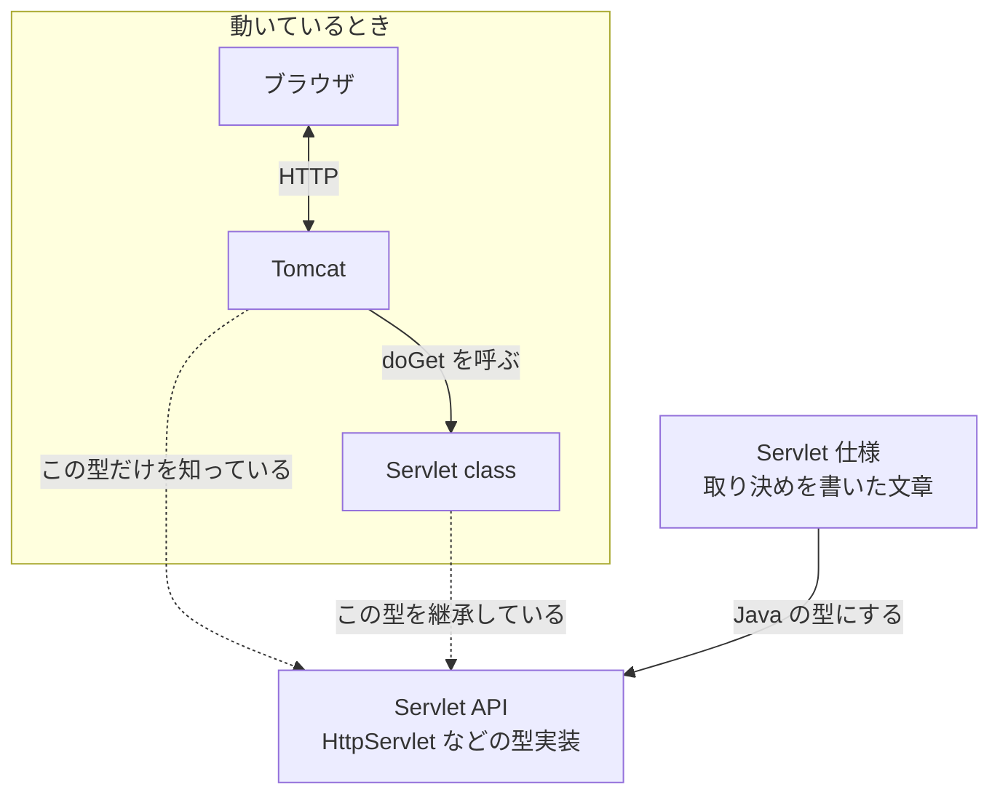

# 仕様、API、Servlet class、Tomcat はどう関係するのか

> 疑問: Tomcat は、自分が書いた Servlet class の中身を知らない。それなのに、なぜ呼び出せるのか。
>
> 答え: Tomcat と Servlet class が、Servlet 仕様という同じ取り決めに従っているからです。Servlet API は、その取り決めを Java の型にしたものです。

## 取り決めがあれば、相手を知らなくてよい

コンセントとプラグを思い浮かべてください。家電を作る人は、どの家のコンセントに挿されるかを知りません。それでも動くのは、コンセントとプラグの形が取り決められているからです。

Tomcat と Servlet class も同じです。

- Tomcat を作った人は、あなたの `HelloServlet` を知らない
- あなたは、Tomcat の中身を知らない
- それでも、両方が Servlet 仕様に従っているので、つながる

プログラムでは、これを Java の継承で実現しています。

Java では、変数の型を親クラスにしておくと、そのクラスを継承したどのクラスのオブジェクトでも入れられます。その変数でメソッドを呼ぶと、入っているオブジェクトがもつメソッドが動きます。動くのは`HttpServlet`から継承してオーバーライドしたメソッドです。

Tomcat の中は、イメージとしては次のようになっています。

```java
// Tomcat の中（イメージ）
HttpServlet servlet = パスに対応する Servlet class のオブジェクト;
servlet.doGet(request, response);
```

- Tomcat のコードに出てくるのは、Servlet API の `HttpServlet` 型だけで、`HelloServlet` という名前は出てこない
- 変数 `servlet` に実際に入っているのは、あなたの `HelloServlet` のオブジェクト
- そのため、`doGet` を呼ぶと、あなたが上書きした `doGet` が動く

Tomcat は `HttpServlet` だけを知っていればよく、あなたは `HttpServlet` を継承して `doGet` を上書きすればよい、ということです。この `HttpServlet` が、コンセントとプラグの「形」に当たります。

## 4つの関係

ここまでに出てきた4つは、次のように関係しています。



実線は動いているときの呼び出しを、点線は型の関係を表します。

- ブラウザがやり取りする相手は Tomcat。ブラウザが Servlet class と直接やり取りすることはない
- Tomcat は、Servlet class の `doGet` を呼び出す
- Tomcat が知っているのは、Servlet API の型だけ
- Servlet class は、Servlet API の `HttpServlet` を継承して書く
- Servlet API は、Servlet 仕様を Java の型にしたもの

## 同じ Servlet API でコンパイルする

Tomcat と Servlet class は、どちらも Servlet API を使ってコンパイルされています。両方が同じ Servlet 仕様に従うためです。

Servlet API は、仕様を Java の型にしたものです。そのため、仕様に従っているかを、コンパイラが確かめられます。たとえば、`HttpServlet` を継承していなかったり、`doGet` の引数の型を間違えたりすると、コンパイルエラーになります。

Tomcat の開発者も、あなたも、同じ型を使ってコンパイルします。だから、お互いを知らなくても、形が合います。

Servlet API は、動かすときには1つあれば足ります。それは Tomcat が持っているので、自分のアプリには入れません。[Servlet とは何か](02-what-is-servlet.md) で `provided` を指定したのは、このためです。

---

## 参考文献

この章では、わかりやすさを優先して説明を単純にしています。正確な仕組みや、さらに詳しい内容は次の資料で学べます。

Servlet の仕様と API:

- [Jakarta Servlet 6.1（仕様）](https://jakarta.ee/specifications/servlet/6.1/)
- [Jakarta Servlet 6.1 API ドキュメント](https://jakarta.ee/specifications/servlet/6.1/apidocs/)
- [Jakarta EE（Wikipedia）](https://ja.wikipedia.org/wiki/Jakarta_EE)。Servlet が含まれる仕様の集まりと、名前が変わった経緯

Tomcat のドキュメント:

- [Apache Tomcat 11 Documentation](https://tomcat.apache.org/tomcat-11.0-doc/)
- [Application Developer's Guide（Tomcat でアプリを作る手順）](https://tomcat.apache.org/tomcat-11.0-doc/appdev/index.html)
- [Tomcat Web Application Deployment（アプリの載せ方）](https://tomcat.apache.org/tomcat-11.0-doc/deployer-howto.html)

自分で Web サーバを書く方法:

- [Lesson: All About Sockets（Java Tutorials）](https://docs.oracle.com/javase/tutorial/networking/sockets/)

---

前: [Tomcat とは何か](03-what-is-tomcat.md) ｜ 次: [3章 Servlet class の呼び出し](../03-servlet-invocation/README.md)
