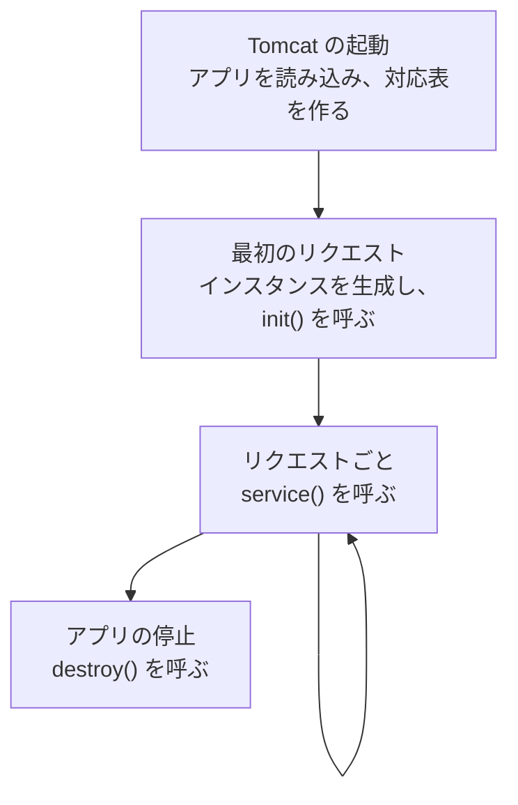
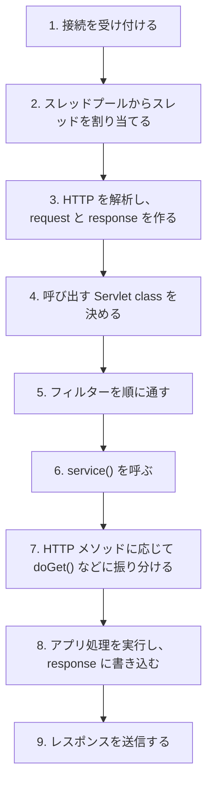

# リクエストから Servlet class が呼ばれるまでに何が起こるのか

> 疑問: Tomcat はどのような流れで Servlet class を呼び出すのか。
>
> 答え: 起動時に URL と Servlet class の対応表を作り、リクエストのたびにそれを使って呼び出します。

## ライフサイクル全体



`load-on-startup` を設定すると、最初のリクエストを待たず、アプリの起動時に生成と初期化を行えます。

## リクエストごとの処理

`GET /myapp/hello?name=taro` の例です。



## 呼び出し先の決定

URL を2段階で照合します。

```text
/myapp/hello
  │     └─ Servlet class を選ぶ: /hello → HelloServlet
  └─ アプリを選ぶ: /myapp → myapp.war
```

対応する Servlet class がなければ、Tomcat が 404 を返します。この場合、自分のコードは呼ばれません。

## フィルター

フィルターは、Servlet class の前後に認証やログなどの共通処理を挟む仕組みです。フィルターが処理を止めると、Servlet class は呼ばれません。

## Servlet class から見た流れ

Servlet class は自分で接続を待ったりスレッドを作ったりしません。生成から呼び出し、破棄まで Tomcat が管理するので、呼ばれたときの処理だけを書きます。

---

前: [URL と Servlet class をどう対応付けるのか](01-url-mapping.md) ｜ 次: [`doGet()` や `doPost()` は誰が振り分けるのか](03-service-dispatch.md)
