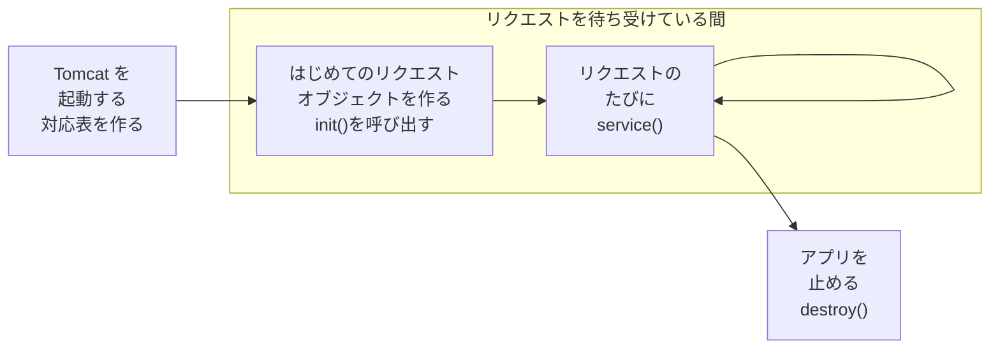

# リクエストから Servlet class が呼ばれるまでに何が起こるのか

> 疑問: リクエストが届いてから `doGet` が呼ばれるまでに、Tomcat の中では何が起きているのか。
>
> 答え: Tomcat は、リクエストを読み取り、パスから Servlet class を選び、リクエストを処理するメソッドを呼びます。Servlet class のオブジェクトは、はじめに1回だけ作っておきます。

## リクエストが来る前の準備

Java でクラスのメソッドを呼び出すには、そのクラスのオブジェクトが必要です。しかし、Servlet class のオブジェクトを作る（`new HelloServlet()` を書く）のは自分ではなく、Tomcat です。Tomcat は、オブジェクトを作ったあとに、`init()` というメソッドを呼んで初期化します。

また、Tomcat は Servlet class のオブジェクトを、リクエストのたびに作るわけではありません。はじめて必要になったときに1つだけ作り、そのあとはずっと使い回します。リクエストのたびに作り直して準備をやり直すと、そのぶん時間がかかるからです。



それぞれのメソッドは、次のときに呼ばれます。

- `init()`: オブジェクトを作った直後に1回だけ。準備の処理（設定を読み込むなど）を書ける
- `service()`: リクエストが来るたびに呼ばれる。ここから `doGet` が呼ばれる（[次のページ](03-service-dispatch.md) で説明する）
- `destroy()`: アプリを止めるときに1回だけ。後片付けの処理（開いたものを閉じるなど）を書ける

`init()` と `destroy()` は、必要なときだけ書けば十分です。

## リクエストが来たとき

`http://localhost:8080/myapp/hello?name=taro` が開かれると、Tomcat は次の手順で処理します。

1. リクエストの文字を受け取る
2. 文字を部品に分けて `HttpServletRequest` に格納し、`HttpServletResponse` を用意する
3. パスを見て、アプリと Servlet class を選ぶ
4. 選んだ Servlet class の `service()` を呼ぶ
5. `service()` が、HTTP メソッドを見て `doGet()` を呼ぶ
6. `doGet()` が `req` を読み、`resp` に中身を書く
7. `resp` の中身を HTTP の文字にして、ブラウザに送る

自分で書くのは、6 の部分だけです。ここから、手順を1つずつ見ていきます。

## 1〜2: リクエストの文字をオブジェクトに格納する

Tomcat に届くのは、ただの文字です。`doGet` は、この中のパスやクエリを、どうやって受け取るのでしょうか。

```http
GET /myapp/hello?name=taro HTTP/1.1
Host: localhost:8080
User-Agent: Mozilla/5.0

```

これは、[1章4節](../01-web-basics/04-what-is-http.md) で見たリクエストと同じ形です。[2章1節](../02-servlet-and-tomcat/01-java-web-server.md) の `RawServer` は、この文字を `readLine()` で読んでいました。文字のままでは、パスやクエリを使うたびに、自分で文字を切り分けなければなりません。

Tomcat は、この文字を HTTP の決まりに沿って部品に分け、`HttpServletRequest` 型のオブジェクトに格納します。あわせて、これから返すレスポンスを書き込むための `HttpServletResponse` 型のオブジェクトも用意します。`doGet` の引数の `req` と `resp` は、この2つのオブジェクトです。

## 3: パスを見て Servlet class を選ぶ

Tomcat が呼び出す Servlet class は、リクエストのどこを見て決まるのでしょうか。

Tomcat は、パスを前から2回に分けて見ます。まず `/myapp` でアプリを選び、次に `/hello` で、そのアプリの中の Servlet class を選びます。`/hello` から Servlet class を選ぶときに使うのが、[1節](01-url-mapping.md) で見た対応表です。

当てはまる Servlet class がなければ、Tomcat が `404 Not Found` のレスポンスを返します。このとき、自分のコードは呼ばれません。

## 4〜5: `service()` が `doGet()` を選ぶ

Servlet class を選んだ Tomcat は、`doGet` を直接呼ぶのでしょうか。

Tomcat が呼ぶのは、`service()` だけです。`service()` は、`HelloServlet` (自分の書いた Servlet Class) が `HttpServlet` から受け継いだメソッドです。この `service()` が `GET` を見て、`doGet` を選んで呼びます。仕組みは次のページで説明します。

## 6〜7: `doGet()` がレスポンスを書く

パスと HTTP メソッドは、呼ぶ先を選ぶのに使いました。では、クエリやヘッダーは何に使うのでしょうか。

クエリやヘッダーは、呼ぶ先を選ぶのには使いません。`req` に格納したまま `doGet` に渡し、`doGet` の中で使います。たとえば `name=taro` を見て「こんにちは、taro」と返すのは、自分で書く `doGet` の仕事です。

`doGet` は、返す中身を `resp` に書きます。`doGet` が終わると、Tomcat が `resp` の中身を HTTP の文字にして、ブラウザに送ります。`req` と `resp` の使い方は、[4章1節](../04-html-response/01-request-and-response.md) で説明します。

## まとめ: リクエストのどこで何が決まるか

ここまでの手順を、リクエストの文字の側から見直すと、次のようになります。

```text
GET /myapp/hello?name=taro HTTP/1.1
─┬─ └─┬──┘└─┬──┘└───┬────┘
 │    │     │       └─ 何も選ばない。doGet() の中で使う
 │    │     └─ Tomcat が Servlet class を選ぶ（HelloServlet）
 │    └─ Tomcat がアプリを選ぶ（myapp.war）
 └─ service() が doGet() を選ぶ
```

ヘッダーも、クエリと同じく何も選ばず、`doGet` の中で使います。

パスと HTTP メソッドは「どこに届けるか」を決め、クエリやヘッダーは「届けた先で使う中身」になります。

## 補足: フィルター

3 と 4 の間に、フィルターという処理を挟むこともできます。フィルターは、たくさんの Servlet class に共通する処理を、まとめて書くための仕組みです。たとえば、ログインしているかどうかの確認や、「いつ、どのパスが開かれたか」を記録する処理に使います。

---

前: [URL と Servlet class をどう対応付けるのか](01-url-mapping.md) ｜ 次: [`doGet()` や `doPost()` は誰が振り分けるのか](03-service-dispatch.md)
