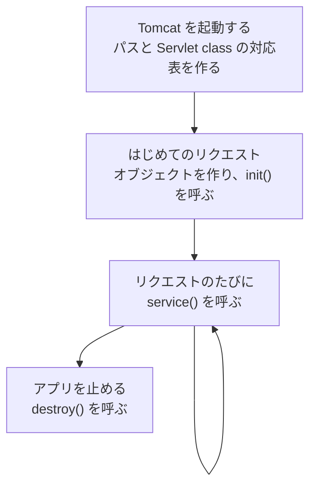
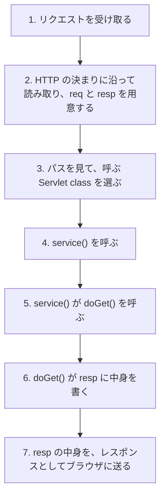

# リクエストから Servlet class が呼ばれるまでに何が起こるのか

> 疑問: リクエストが届いてから `doGet` が呼ばれるまでに、Tomcat の中では何が起きているのか。
>
> 答え: Tomcat は、リクエストを読み取り、パスから Servlet class を選び、そのメソッドを呼びます。Servlet class のオブジェクトは、はじめに1回だけ作っておきます。

## Servlet class のオブジェクトを作る

Servlet class を呼ぶには、そのクラスのオブジェクトが必要です。`new HelloServlet()` を書くのは自分ではなく、Tomcat です。

Tomcat は、Servlet class のオブジェクトを、リクエストのたびに作るわけではありません。はじめて必要になったときに1つだけ作り、そのあとはずっと使い回します。



それぞれのメソッドは、次のときに呼ばれます。

- `init()`: オブジェクトを作った直後に1回だけ。準備の処理を書ける
- `service()`: リクエストが来るたびに。次のファイルで説明するように、ここから `doGet` が呼ばれる
- `destroy()`: アプリを止めるときに1回だけ。後片付けの処理を書ける

`init()` と `destroy()` は、必要なときだけ書けば十分です。

## リクエストが来るたびにすること

`http://localhost:8080/myapp/hello?name=taro` が開かれたときの流れは、次のとおりです。



自分で書くのは、6 の部分だけです。

## Servlet class を選ぶ

3 の手順では、パスを前から2回に分けて見ます。

```text
/myapp/hello
  │     └─ 2回目: Servlet class を選ぶ  /hello → HelloServlet
  └─ 1回目: アプリを選ぶ  /myapp → myapp.war
```

当てはまる Servlet class がなければ、Tomcat が `404 Not Found` を返します。このとき、自分のコードは呼ばれません。

## 補足: フィルター

3 と 4 の間に、フィルターという処理を挟むこともできます。フィルターは、たくさんの Servlet class に共通する処理を、まとめて書くための仕組みです。たとえば、ログインしているかどうかの確認や、記録を残す処理に使います。

---

前: [URL と Servlet class をどう対応付けるのか](01-url-mapping.md) ｜ 次: [`doGet()` や `doPost()` は誰が振り分けるのか](03-service-dispatch.md)
