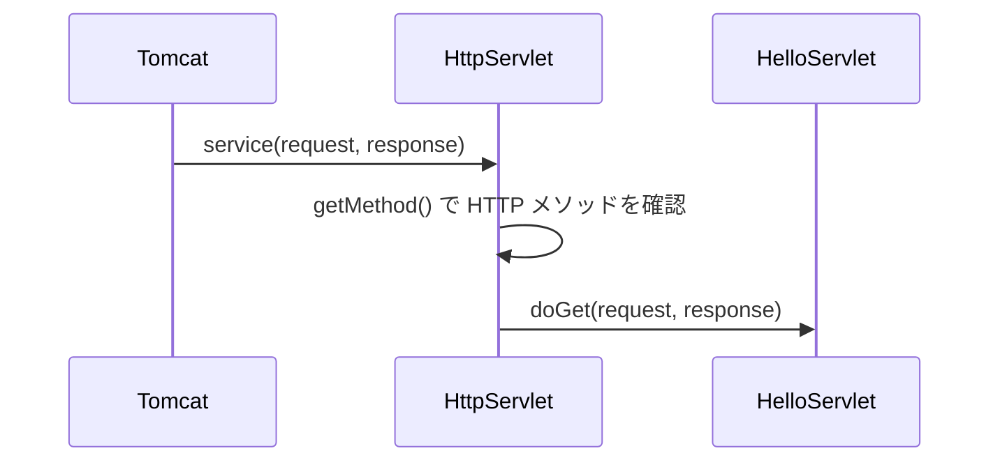

# `doGet()` や `doPost()` は誰が振り分けるのか

> 疑問: HTTP メソッドに応じたメソッドの呼び出しは、誰が決めているのか。
>
> 答え: Servlet API の `HttpServlet` が持つ `service()` です。Tomcat が直接 `doGet()` を呼ぶわけではありません。この振り分けは Servlet 仕様に定められています。

## 呼び出しの流れ

`HelloServlet` は `HttpServlet` を継承しているので、自分で `service()` を書かなくても、この振り分けを受け継ぎます。Tomcat は `service()` だけを呼べばよいので、個々の Servlet class の中身を知らなくても同じ方法で呼び出せます。

## 担当の分担

| 段階 | 決めること | 担当 |
|---|---|---|
| 1. HTTP の解析 | メソッドやパスの読み取り | Tomcat |
| 2. 呼び出し先の選択 | どの Servlet class を使うか | Tomcat |
| 3. `service()` の呼び出し | 選んだ Servlet class の入口を呼ぶ | Tomcat |
| 4. メソッドの振り分け | `doGet()` と `doPost()` のどれを呼ぶか | `HttpServlet.service()` |
| 5. アプリ処理 | 何を返すか | 自分の Servlet class |

## 実装しなかったメソッド

`doPost()` だけを実装した URL に GET でアクセスすると、`HttpServlet` が用意する `doGet()` が動き、通常は `405 Method Not Allowed` を返します。

## 仕様で決まっていること

| 項目 | 仕様での扱い |
|---|---|
| コンテナが `service()` を呼ぶこと | 定められている |
| `HttpServlet` が HTTP メソッドごとに振り分けること | 定められている |
| Tomcat 内部での HTTP の解析方法 | 定められていない |
| スレッドプールなど Tomcat 内部の構成 | 定められていない |

つまり、Tomcat と Servlet class の接点は仕様で決まっていて、Tomcat の内部の作りは自由です。

Tomcat も `servlet-api.jar` として `HttpServlet` のコードを同梱していますが、仕様どおりに動く必要があるので、Tomcat 独自の振り分けにはなりません。

---

前: [リクエストから Servlet class が呼ばれるまでに何が起こるのか](02-request-flow.md) ｜ 次: [Servlet class は同時アクセスをどう処理するのか](04-instance-and-threads.md)
