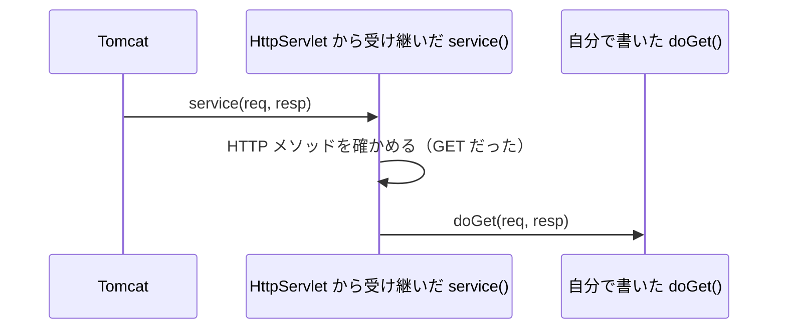

# `doGet()` や `doPost()` は誰が振り分けるのか

> 疑問: `doGet` という名前のメソッドを書いただけで、なぜ `GET` のときに呼ばれるのか。
>
> 答え: `HttpServlet` から受け継いだ `service()` が、HTTP メソッドを見て `doGet` か `doPost` を呼び分けているからです。

## Tomcat が呼ぶのは `service()` だけ

Tomcat は、どの Servlet class に対しても、同じ `service()` というメソッドを呼びます。`doGet` を直接呼ぶわけではありません。

`service()` は、自分では書いていません。`HelloServlet` は `extends HttpServlet` と書いたので、`HttpServlet` が持つ `service()` を受け継いでいます。

## `service()` がすること

`HttpServlet` の `service()` は、リクエストの HTTP メソッドを見て、呼ぶメソッドを選びます。

- `GET` なら `doGet()` を呼ぶ
- `POST` なら `doPost()` を呼ぶ

このしくみのおかげで、自分は `doGet` や `doPost` に、それぞれのときの処理を書くだけで済みます。

## 誰が何を決めているか

リクエストが届いてから処理が終わるまでに、決めることと担当は次のとおりです。

1. HTTP を読み取る: Tomcat
2. どの Servlet class を呼ぶかを選ぶ: Tomcat
3. 選んだ Servlet class の `service()` を呼ぶ: Tomcat
4. `doGet` と `doPost` のどちらを呼ぶかを選ぶ: `HttpServlet` の `service()`
5. 何を返すかを決める: 自分で書いた `doGet` や `doPost`

## 書いていないメソッドが呼ばれたとき

`doPost` だけを書いた Servlet class に、`GET` のリクエストが来たとします。

このとき、`HttpServlet` が用意している `doGet` が呼ばれます。このメソッドは、`405 Method Not Allowed`（その HTTP メソッドには対応していない）を返します。

## この振り分けは決まりの一部

`service()` が HTTP メソッドで振り分けることは、Servlet 仕様で決まっています。そのため、Tomcat 以外のサーブレットコンテナでも、`doGet` は同じように呼ばれます。

一方、Tomcat が HTTP をどう読み取るかなど、Tomcat の中の作りは仕様で決まっていません。仕様で決まっているのは、Tomcat と Servlet class がつながる部分だけです。

---

前: [リクエストから Servlet class が呼ばれるまでに何が起こるのか](02-request-flow.md) ｜ 次: [Servlet class は同時アクセスをどう処理するのか](04-instance-and-threads.md)
