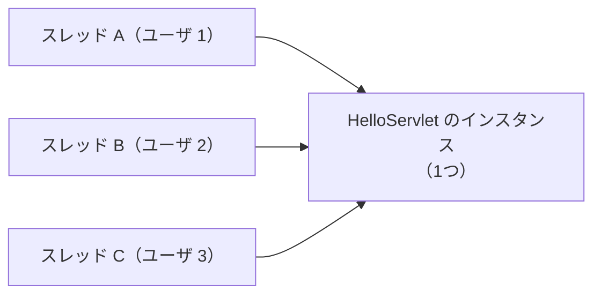

# Servlet class は同時アクセスをどう処理するのか

> 疑問: 複数のユーザが同時にアクセスすると、Servlet class はどう動くのか。
>
> 答え: 通常、1つのインスタンスの `doGet()` などを複数のスレッドが同時に実行します。

## インスタンスとスレッドの関係



## 変数の扱い

| 変数の種類 | スレッド間での扱い | リクエストごとの値の保持 |
|---|---|---|
| ローカル変数 | スレッドごとに分かれる | 問題ない |
| インスタンス変数 | 共有される | してはいけない |

## 問題のある例

```java
@WebServlet("/hello")
public class HelloServlet extends HttpServlet {
    private String name;   // 全スレッドで共有される

    @Override
    protected void doGet(HttpServletRequest req, HttpServletResponse resp) throws IOException {
        name = req.getParameter("name");
        resp.getWriter().println("こんにちは、" + name);
    }
}
```

ユーザ 1 の処理が `name` を設定した直後に、ユーザ 2 の処理が `name` を上書きすると、ユーザ 1 にユーザ 2 の名前が表示されるかもしれません。

## 修正した例

リクエストごとの値は、ローカル変数に持ちます。

```java
@WebServlet("/hello")
public class HelloServlet extends HttpServlet {
    @Override
    protected void doGet(HttpServletRequest req, HttpServletResponse resp) throws IOException {
        String name = req.getParameter("name");
        resp.getWriter().println("こんにちは、" + name);
    }
}
```

全リクエストで共有する前提の値をインスタンス変数に持つ場合は、スレッドセーフなクラスを使います。例は [PRG パターン](../06-input-and-redirect/03-prg-pattern.md) にあります。

---

前: [`doGet()` や `doPost()` は誰が振り分けるのか](03-service-dispatch.md) ｜ 次: [リクエストとレスポンスをどう扱うのか](../04-html-response/01-request-and-response.md)
