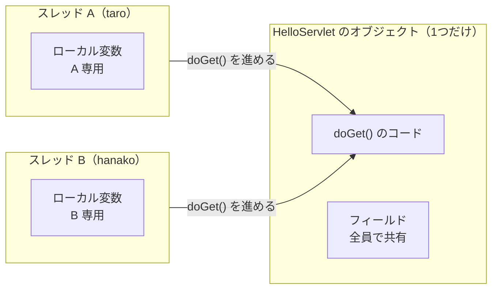
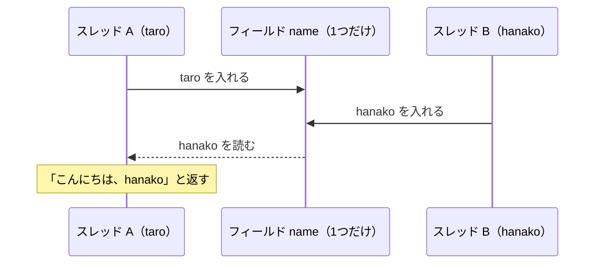

# Servlet class は同時アクセスをどう処理するのか

> 疑問: 2人が同時に `/hello` を開いたら、`HelloServlet` はどう動くのか。
>
> 答え: 1つの `HelloServlet` のオブジェクトの `doGet` を、2つの処理が同時に進めます。そのため、フィールドに値を入れると、2人の値が混ざることがあります。

## 同時に進む処理: スレッド

Tomcat は、たくさんのリクエストに同時に返事をします。そのために、リクエストごとに、処理を進める担当を1つ割り当てます。この担当をスレッドと呼びます。

いつものプログラムは、上から順に1行ずつ進む処理が1本だけです。Tomcat の中では、この処理が何本も同時に進んでいます。
Tomcatはあらかじめスレッドをいくつか用意しておき、それぞれのスレッドがリクエストの処理を担当します。

## オブジェクトは1つだけ

[2節](02-request-flow.md) で説明したとおり、`HelloServlet` のオブジェクトは1つしか作りません。そのため、たくさんのスレッドが、同じ1つのオブジェクトの `doGet` の処理を同時に進めます。



1つの台所で、何人もの料理人が同時に料理している様子を思い浮かべてください。台所（オブジェクト）には、レシピ（`doGet` のコード）とホワイトボード（フィールド）が1つずつあります。料理人（スレッド）は、同じレシピを見ながら、それぞれ手元のメモ（ローカル変数）を使って料理します。

## 変数は2種類で扱いが違う

`doGet` から使う変数は、どこで宣言するかで扱いが変わります。

- メソッドの中で宣言した変数（ローカル変数）: メソッドを呼ぶたびに新しく用意されるので、スレッドごとに別々になる。料理人それぞれの手元のメモにあたる
- クラスのフィールド: オブジェクトに1つだけあり、全部のスレッドで共有される。台所に1枚だけあるホワイトボードにあたる

リクエストごとに違う値は、ローカル変数に入れます。

## まちがった例

次のコードは、名前をフィールドの `name` に入れています。

```java
@WebServlet("/hello")
public class HelloServlet extends HttpServlet {
    private String name;   // 全部のスレッドで共有される

    @Override
    protected void doGet(HttpServletRequest req, HttpServletResponse resp) throws IOException {
        name = req.getParameter("name");
        resp.getWriter().println("こんにちは、" + name);
    }
}
```

`taro` さんと `hanako` さんが、ほぼ同時に開いたとします。



`taro` さんの画面に、`hanako` さんの名前が出てしまいます。

## 直した例

名前を、`doGet` の中のローカル変数に入れます。

```java
@WebServlet("/hello")
public class HelloServlet extends HttpServlet {
    @Override
    protected void doGet(HttpServletRequest req, HttpServletResponse resp) throws IOException {
        String name = req.getParameter("name");
        resp.getWriter().println("こんにちは、" + name);
    }
}
```

`name` はスレッドごとに別々なので、2人の値は混ざりません。

## 全員で共有したい値

訪問者の数や、全員で書き足していくリストのように、全部のリクエストで共有したい値もあります。このような値をフィールドに入れるときは、同時に使っても壊れないように作られたクラスを使います。[6章3節](../06-input-and-redirect/03-prg-pattern.md) に、リストの例があります。

---

## 参考文献

この章では、わかりやすさを優先して説明を単純にしています。正確な仕組みや、さらに詳しい内容は次の資料で学べます。

Servlet 仕様の該当する章:

- [Jakarta Servlet 6.1 仕様: The Servlet Interface（オブジェクトの生成、`service()`、スレッド）](https://jakarta.ee/specifications/servlet/6.1/jakarta-servlet-spec-6.1.html#the-servlet-interface)
- [Jakarta Servlet 6.1 仕様: Mapping Requests to Servlets（パスの書き方と選ばれ方）](https://jakarta.ee/specifications/servlet/6.1/jakarta-servlet-spec-6.1.html#mapping-requests-to-servlets)
- [Jakarta Servlet 6.1 仕様: Filtering（フィルター）](https://jakarta.ee/specifications/servlet/6.1/jakarta-servlet-spec-6.1.html#filtering)

入門向けの解説:

- [Jakarta EE Tutorial: Jakarta Servlet Technology](https://jakarta.ee/learn/docs/jakartaee-tutorial/current/web/servlets/servlets.html)
- [Overriding and Hiding Methods（Java Tutorials。メソッドの上書きと `@Override`）](https://docs.oracle.com/javase/tutorial/java/IandI/override.html)
- [Lesson: Concurrency（Java Tutorials。スレッドの基本）](https://docs.oracle.com/javase/tutorial/essential/concurrency/)

Tomcat のドキュメント:

- [The Executor（Tomcat がスレッドを用意するしくみの設定）](https://tomcat.apache.org/tomcat-11.0-doc/config/executor.html)

---

前: [`doGet()` や `doPost()` は誰が振り分けるのか](03-service-dispatch.md) ｜ 次: [4章 HTML を返す](../04-html-response/README.md)
