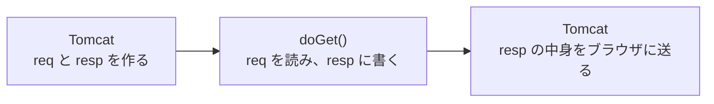

# リクエストとレスポンスをどう扱うのか

> 疑問: `doGet` の引数の `req` と `resp` は、何に使うのか。
>
> 答え: `req` は届いたリクエストで、ここから値を読みます。`resp` はこれから返すレスポンスで、ここに中身を書き込みます。

## 入力は `req`、出力は `resp`

いつものプログラムは、キーボードから入力を読み、画面に出力します。

Servlet class では、読む先と書く先が変わります。

- 入力: `req`（`HttpServletRequest`）から読む
- 出力: `resp`（`HttpServletResponse`）に書く

どちらも、Tomcat がリクエストのたびに作って、`doGet` に渡してくれます。

## 例: 名前を受け取って挨拶する

`/hello?name=太郎` を開くと「こんにちは、太郎」と返す Servlet class です。

```java
@WebServlet("/hello")
public class HelloServlet extends HttpServlet {
    @Override
    protected void doGet(HttpServletRequest req, HttpServletResponse resp) throws IOException {
        String name = req.getParameter("name");

        resp.setContentType("text/plain; charset=UTF-8");
        resp.getWriter().println("こんにちは、" + name);
    }
}
```

`doGet` の戻り値は `void` です。結果は `return` で返さず、`resp` に書き込みます。書き込んだ中身は、`doGet` が終わったあとに Tomcat がブラウザへ送ります。



## `req` から読めるもの

よく使うのは、次のメソッドです。

- `req.getParameter("name")`: クエリの `name` の値。`?name=太郎` なら `太郎`
- `req.getMethod()`: HTTP メソッド。`GET` など
- `req.getHeader("User-Agent")`: ヘッダーの値

`getParameter` は、その名前の値がリクエストにないとき `null` を返します。`/hello` だけを開くと、`name` は `null` になります。

## `resp` に書けるもの

レスポンスの部品ごとに、書くためのメソッドがあります。

- `resp.setStatus(404)`: ステータスコード。書かなければ `200`
- `resp.setContentType("text/plain; charset=UTF-8")`: ボディの種類と文字コード
- `resp.setHeader("名前", "値")`: その他のヘッダー
- `resp.getWriter().println("...")`: ボディ

## 書く順番

ステータスコードとヘッダーは、ボディより先に書きます。

HTTP のレスポンスでは、ステータス行とヘッダーが、ボディより前に並んでいました。ボディを送り始めたあとでは、前の部分を書き直せません。特に `setContentType` の文字コードは、`getWriter()` より前に書かないと効きません。

送るタイミングは [レスポンスはいつ送信されるのか](03-response-commit.md) で詳しく説明します。

## `System.out.println` はブラウザに届かない

`println` は、どのオブジェクトの `println` を呼ぶかで、書き込む先が変わります。

- `resp.getWriter().println("a")`: レスポンスのボディに書く。ブラウザに届く
- `System.out.println("a")`: Tomcat を動かしている画面やログに書く。ブラウザには届かない

`System.out.println` で書いた内容は、Tomcat の `logs/catalina.out` などで見られます。動きを確かめるための記録に使えます。

---

前: [4章 HTML を返す](README.md) ｜ 次: [HTML をレスポンスとして返すにはどうするのか](02-return-html.md)
