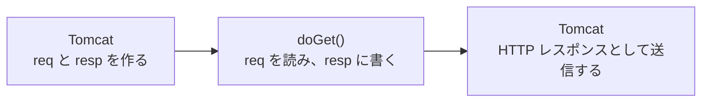

# リクエストとレスポンスをどう扱うのか

> 疑問: Servlet class でリクエストをどう受け取り、レスポンスをどう作るのか。
>
> 答え: Tomcat が作った `HttpServletRequest` と `HttpServletResponse` が引数で渡されます。前者から値を読み、後者に結果を書き込みます。

## 例

`GET /hello?name=太郎` に挨拶を返します。

```java
@WebServlet("/hello")
public class HelloServlet extends HttpServlet {
    @Override
    protected void doGet(HttpServletRequest req, HttpServletResponse resp) throws IOException {
        String name = req.getParameter("name");

        resp.setStatus(HttpServletResponse.SC_OK);
        resp.setContentType("text/plain; charset=UTF-8");
        resp.getWriter().println("こんにちは、" + name);
    }
}
```

メソッドの戻り値は `void` です。結果は `return` で返さず、`resp` に書き込みます。



## リクエストの読み取り

| 取りたいもの | 書き方 |
|---|---|
| パラメータ | `req.getParameter("name")` |
| HTTP メソッド | `req.getMethod()` |
| ヘッダー | `req.getHeader("User-Agent")` |

指定したパラメータがリクエストにない場合、`getParameter()` は `null` を返します。

## レスポンスの書き込み

| 設定するもの | 書き方 |
|---|---|
| ステータスコード | `resp.setStatus(...)`（省略すると 200） |
| 形式と文字コード | `resp.setContentType(...)` |
| ヘッダー | `resp.setHeader(名前, 値)` |
| 本文 | `resp.getWriter().println(...)` |

## 順番の注意

ステータスと `Content-Type` は、本文より先に設定します。

- `getWriter()` を呼んだ後に文字コードを変更しても反映されません。
- 本文の送信が始まると、ステータスやヘッダーは変更できません。

## `println()` の書き込み先

`println()` の書き込み先は、どのオブジェクトの `println()` かで決まります。

| コード | オブジェクトの型 | 書き込み先 |
|---|---|---|
| `System.out.println("a")` | `PrintStream` | 標準出力 |
| `resp.getWriter().println("a")` | `PrintWriter` | レスポンスボディ |

`System.out.println()` で出力した内容はブラウザには届かず、Tomcat を動かしているプロセスの標準出力に出ます。`bin/startup.sh` で起動した場合は、通常 `logs/catalina.out` に記録されます。

---

前: [Servlet class は同時アクセスをどう処理するのか](../03-servlet-invocation/04-instance-and-threads.md) ｜ 次: [HTML をレスポンスとして返すにはどうするのか](02-return-html.md)
