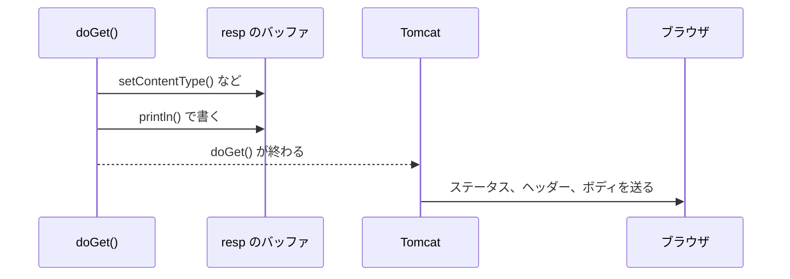

# レスポンスはいつ送信されるのか

> 疑問: `resp` に書いた中身は、いつブラウザに届くのか。
>
> 答え: ふつうは `doGet` が終わったあとです。ただし、書いた量が多いときなどは、`doGet` の途中で送り始めます。

## いったん溜めてから送る

`resp` に書いた中身は、すぐには送られません。まず、バッファという入れ物に溜めておきます。

`doGet` が終わると、Tomcat がバッファの中身をまとめてブラウザに送ります。



## 途中で送り始めるとき

次のときは、`doGet` の途中でも送り始めます。

- バッファがいっぱいになった: 大きなボディを書いたとき
- 送るように頼んだ: `resp.flushBuffer()` を呼んだとき
- 送る用のメソッドを呼んだ: `resp.sendError()` や `resp.sendRedirect()` を呼んだとき

送り始めた状態を、コミットされたと呼びます。`resp.isCommitted()` で確かめられます。

## 送り始めたら書き直せない

送り始めるときは、ステータス行とヘッダーを先に送ります。そのため、送り始めたあとでステータスやヘッダーを変えても、ブラウザには届きません。

```java
resp.getWriter().println("本文");
resp.flushBuffer();                 // ここで送り始める

resp.setStatus(500);                // 届かない
resp.setHeader("X-Sample", "abc");  // 届かない
```

ステータスとヘッダーをボディより先に書くのは、このためです。

## 途中でエラーが起きたとき

`doGet` の中で例外が起きたときも、送り始めたかどうかで結果が変わります。

- 送り始める前: バッファの中身は捨てられる。Tomcat が `500` のエラーページを返す
- 送り始めたあと: ステータスはもう変えられない。ブラウザには `200` と、途中までのボディが届く

---

前: [HTML をレスポンスとして返すにはどうするのか](02-return-html.md) ｜ 次: [入力値を HTML に埋め込むとなぜ危険なのか](04-xss-and-escaping.md)
