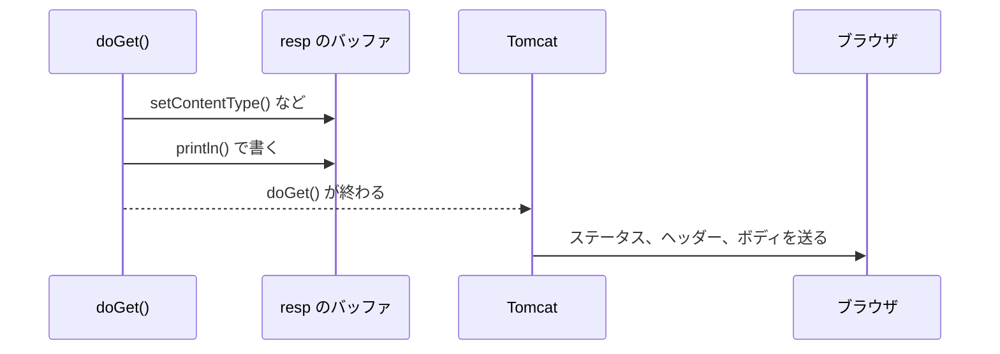

# レスポンスはいつ送信されるのか

> 疑問: `resp` に書いた中身は、いつブラウザに届くのか。
>
> 答え: ふつうは `doGet` が終わったあとです。ただし、書いた量が多いときなどは、`doGet` の途中で送り始めます。

## いったん溜めてから送る

`resp` に書いた中身は、すぐには送られません。まず、バッファに溜めておきます。バッファは、データを送る前に一時的に溜めておく場所です。手紙を1通書くたびにポストへ出しに行くのではなく、机の上の箱に溜めておき、まとめて出す様子を思い浮かべてください。

溜めておけば、`doGet` が終わるまでは、何を返すかを変えられます。たとえば、ボディを書き始めたあとで、探していたデータが見つからないとわかったとします。まだ送っていないので、ステータスを `404` に変えられます。

```java
resp.getWriter().println("検索結果");
// ここで、探していたデータが見つからないとわかった
resp.setStatus(404);   // まだ送っていないので、間に合う
```

すぐに送っていたら、ステータス行はもうブラウザに届いているので、変えられません。

`doGet` が終わると、Tomcat がバッファの中身をまとめてブラウザに送ります。



## 途中で送り始めるとき

次のときは、`doGet` の途中でも送り始めます。

- バッファがいっぱいになった: 大きなボディを書いたとき
- 送るように頼んだ: `resp.flushBuffer()` を呼んだとき
- レスポンスを決めてしまうメソッドを呼んだ: エラーを返す `resp.sendError()` や、リダイレクトする `resp.sendRedirect()`（[6章2節](../06-input-and-redirect/02-what-is-redirect.md)）を呼んだとき

送り始めた状態を、コミットされたと呼びます。`resp.isCommitted()` で確かめられます。

## 送り始めたら書き直せない

送り始めるときは、ステータス行とヘッダーを先に送ります。そのため、送り始めたあとでステータスやヘッダーを変えても、ブラウザには届きません。

```java
resp.getWriter().println("本文");
resp.flushBuffer();                 // ここで送り始める

resp.setStatus(500);                // 届かない
resp.setHeader("X-Sample", "abc");  // 届かない
```

[1節](01-request-and-response.md) で、ステータスとヘッダーをボディより先に書くと説明したのは、このためです。

送り始めたあとに `resp.sendRedirect()` や `resp.sendError()` を呼ぶと、黙って無視されるのではなく、`IllegalStateException` という例外になります。このエラーに出会ったら、その前で送り始めていないかを確かめます。

## 途中でエラーが起きたとき

`doGet` の中で例外が起きたときも、送り始めたかどうかで結果が変わります。

- 送り始める前: バッファの中身は捨てられる。Tomcat が `500` のエラーページを返す
- 送り始めたあと: ステータスはもう変えられない。ブラウザには `200` と、途中までのボディが届く

> コラム: 書いた中身は、どうやって Tomcat に渡るのか
>
> `doGet` は何も返しません。それなのに、`doGet` が書いた中身を、Tomcat はどうやって受け取るのでしょうか。
>
> Tomcat と `doGet` が、同じ1つの `resp` のオブジェクトを使っているからです。`resp` のオブジェクトは、Tomcat がリクエストのたびに作り、`doGet` を呼ぶときに引数として渡します。このとき渡しているのは、オブジェクトのコピーではなく、「このオブジェクト」という指し示しです。Tomcat も、同じオブジェクトを指したまま持っています。
>
> ```java
> // Tomcat の中（イメージ）
> HttpServletResponse resp = レスポンスのオブジェクトを作る;
> servlet.service(req, resp);   // この中で doGet が resp に書き込む
> resp のバッファの中身をブラウザに送る;
> ```
>
> `doGet` が `resp` に書き込むと、その中身は、Tomcat が持っているオブジェクトのバッファに入ります。2人で同じ1冊のノートを使っているようなものです。`doGet` が終わったあと、Tomcat はそのバッファの中身を送ります。
>
> Java では、オブジェクトを引数に渡すと、このように同じオブジェクトを指したものが渡ります。メソッドの中でオブジェクトの中身を変えると、呼び出した側からもその変化が見えます。
>
> 参考: [Passing Information to a Method or a Constructor（Java Tutorials）](https://docs.oracle.com/javase/tutorial/java/javaOO/arguments.html)

---

前: [HTML をレスポンスとして返すにはどうするのか](02-return-html.md) ｜ 次: [入力値を HTML に埋め込むとなぜ危険なのか](04-xss-and-escaping.md)
