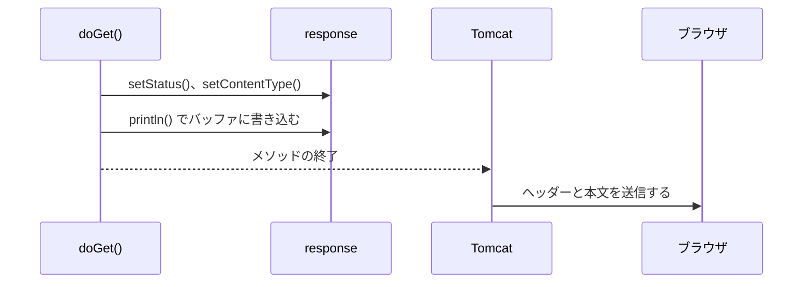

# レスポンスはいつ送信されるのか

> 疑問: メソッドの処理が終わった時点の `HttpServletResponse` の内容がレスポンスになるのか。
>
> 答え: 短いレスポンスならその通りです。ただし、バッファがいっぱいになるなどの場合は、メソッドの途中で送信が始まります。

## 基本の流れ

書き込んだ本文はいったんバッファに溜まり、短いレスポンスならメソッドの終了後に送信されます。



## コミット

ヘッダーの送信が始まり、レスポンスが確定した状態をコミット済みと呼びます。`resp.isCommitted()` で確認できます。

次の場合は、メソッドの途中でコミットされます。

- バッファがいっぱいになった: 大きな本文を書き込んだとき
- 明示的に送信した: `resp.flushBuffer()` や `getWriter().flush()` を呼んだとき
- 送信系のメソッドを呼んだ: `resp.sendError()` や `resp.sendRedirect()` を呼んだとき

コミット後にステータスやヘッダーを変更しても、相手には届きません。

```java
resp.getWriter().println("本文");
resp.flushBuffer();                 // ここで送信が始まる

resp.setStatus(500);                // 無視される
resp.setHeader("X-Sample", "abc");  // 無視される
```

## 例外が起きた場合

`doGet()` が例外を投げて終了すると、結果はコミット済みかどうかで変わります。

| 例外が起きた時点の状態 | 結果 |
|---|---|
| コミット前 | バッファの内容は破棄され、Tomcat が 500 のエラーレスポンスを返す |
| コミット後 | ステータスは変更できず、クライアントには 200 などと途中までの本文が届く |

---

前: [HTML をレスポンスとして返すにはどうするのか](02-return-html.md) ｜ 次: [入力値を HTML に埋め込むとなぜ危険なのか](04-xss-and-escaping.md)
