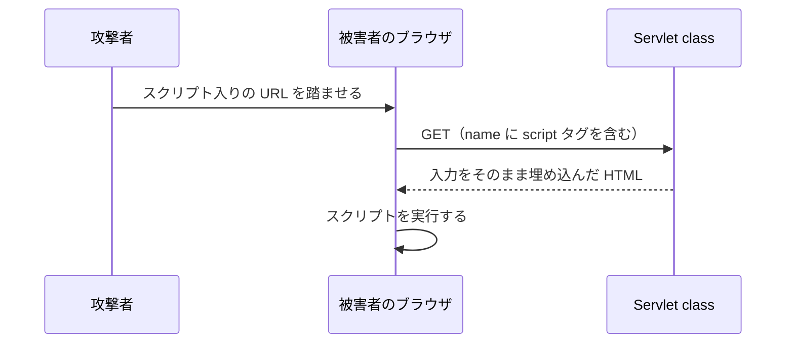

# 入力値を HTML に埋め込むとなぜ危険なのか

> 疑問: ユーザの入力を HTML にそのまま埋め込むと、何が問題なのか。
>
> 答え: 入力に含まれるスクリプトがブラウザで実行される、XSS（クロスサイトスクリプティング）という脆弱性になります。特別な意味を持つ文字をエスケープして防ぎます。

## 問題のある例

```java
String name = req.getParameter("name");
resp.getWriter().println("<h1>こんにちは、" + name + "</h1>");
```

攻撃者が `name` に `<script>` タグを入れた URL を作り、他の人に開かせると、そのスクリプトが相手のブラウザで実行されます。



スクリプトは被害者のページとして動くので、ページの内容の読み取りや操作ができてしまいます。

## エスケープで防ぐ

HTML で特別な意味を持つ文字を、文字として表示される表現に置き換えます。Servlet API にはエスケープ用のメソッドがないので、この環境では自分で書きます。

```java
private static String escapeHtml(String s) {
    return s.replace("&", "&amp;")   // 最初に置き換える
            .replace("<", "&lt;")
            .replace(">", "&gt;")
            .replace("\"", "&quot;")
            .replace("'", "&#39;");
}
```

`&` を最初に置き換えるのは、後の置き換えで生まれた `&lt;` などの `&` を二重に置き換えないためです。

| 文字 | 置き換え後 |
|---|---|
| `&` | `&amp;` |
| `<` | `&lt;` |
| `>` | `&gt;` |
| `"` | `&quot;` |
| `'` | `&#39;` |

## 使い方

`getParameter()` は `null` を返すことがあるので、先に確認します。

```java
String name = req.getParameter("name");
if (name == null) {
    name = "ゲスト";
}
resp.getWriter().println("<h1>こんにちは、" + escapeHtml(name) + "</h1>");
```

この方法は、HTML の本文や引用符で囲んだ属性値に埋め込む場合のものです。`<script>` の中や URL の属性に埋め込む場合は、別の対策が必要です。

---

前: [レスポンスはいつ送信されるのか](03-response-commit.md) ｜ 次: [JSP とは何か](../05-jsp/01-what-is-jsp.md)
