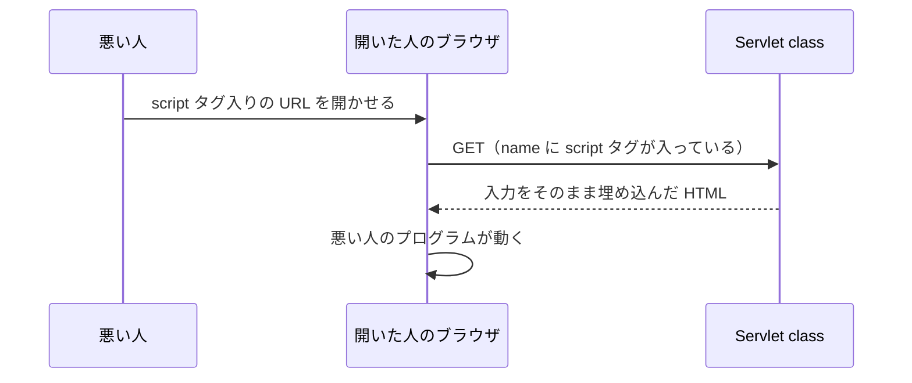

# 入力値を HTML に埋め込むとなぜ危険なのか

> 疑問: 名前の代わりに HTML のタグを入力されたら、どうなるのか。
>
> 答え: タグとして動いてしまいます。`<script>` を入力されると、他の人のブラウザで勝手にプログラムを動かされます。これを防ぐには、タグに使う文字を別の書き方に置き換えます。

## タグを入力されると

名前を受け取って、HTML に埋め込む Servlet class を考えます。

```java
String name = req.getParameter("name");
resp.getWriter().println("<h1>こんにちは、" + name + "</h1>");
```

`name` に `<b>太郎</b>` を入れると、返す HTML は次のようになります。

```html
<h1>こんにちは、<b>太郎</b></h1>
```

ブラウザは `<b>` をタグとして読むので、「太郎」が太字になります。入力した文字が、HTML の一部として動いてしまいました。

## `<script>` を入力されると

`<script>` は、ブラウザに JavaScript のプログラムを動かさせるタグです。これを `name` に入れると、そのプログラムがブラウザで動きます。

悪い人は、`<script>` を入れた URL を作り、他の人に開かせることができます。開いた人のブラウザでは、悪い人のプログラムが、そのサイトのページとして動きます。ページの中身を盗み見たり、勝手に操作したりできてしまいます。



この弱点を、XSS（クロスサイトスクリプティング）と呼びます。

## タグに使う文字を置き換える

防ぐには、HTML で特別な意味を持つ文字を、「その文字そのものを表示する」という書き方に置き換えます。たとえば `<` を `&lt;` に置き換えると、ブラウザは `<` という文字を表示するだけで、タグとしては読みません。

この置き換えを、エスケープと呼びます。置き換える文字は、次の5つです。

| 文字 | 置き換えたあと |
|---|---|
| `&` | `&amp;` |
| `<` | `&lt;` |
| `>` | `&gt;` |
| `"` | `&quot;` |
| `'` | `&#39;` |

Servlet API には、エスケープするメソッドがありません。そのため、自分で書きます。

```java
private static String escapeHtml(String s) {
    return s.replace("&", "&amp;")   // 最初に置き換える
            .replace("<", "&lt;")
            .replace(">", "&gt;")
            .replace("\"", "&quot;")
            .replace("'", "&#39;");
}
```

`&` を最初に置き換えるのには理由があります。あとで置き換えると、`<` から作った `&lt;` の `&` まで、もう一度置き換えてしまうからです。

## 使い方

名前を HTML に埋め込む前に、`escapeHtml` を通します。`getParameter` は `null` を返すことがあるので、先に確かめます。

```java
String name = req.getParameter("name");
if (name == null) {
    name = "ゲスト";
}
resp.getWriter().println("<h1>こんにちは、" + escapeHtml(name) + "</h1>");
```

これで `<b>太郎</b>` を入力されても、`<b>` は文字として表示されるだけになります。

この方法で守れるのは、タグの間や、`"` で囲んだ属性の値に埋め込むときです。`<script>` タグの中や、`href` の URL に埋め込むときは、別の対策が必要です。

---

## 参考文献

この章では、わかりやすさを優先して説明を単純にしています。正確な仕組みや、さらに詳しい内容は次の資料で学べます。

Servlet 仕様の該当する章:

- [Jakarta Servlet 6.1 仕様: The Request（`req` から読めるもの）](https://jakarta.ee/specifications/servlet/6.1/jakarta-servlet-spec-6.1.html#the-request)
- [Jakarta Servlet 6.1 仕様: The Response（`resp` への書き方）](https://jakarta.ee/specifications/servlet/6.1/jakarta-servlet-spec-6.1.html#the-response)
- [Jakarta Servlet 6.1 仕様: Buffering（バッファと送り始めるタイミング）](https://jakarta.ee/specifications/servlet/6.1/jakarta-servlet-spec-6.1.html#buffering)

`Content-Type` について:

- [Content-Type（MDN）](https://developer.mozilla.org/ja/docs/Web/HTTP/Reference/Headers/Content-Type)

XSS とその防ぎ方:

- [クロスサイトスクリプティング（XSS）（MDN）](https://developer.mozilla.org/ja/docs/Web/Security/Attacks/XSS)
- [安全なウェブサイトの作り方（IPA）](https://www.ipa.go.jp/security/vuln/websecurity/about.html)
- [Cross Site Scripting Prevention Cheat Sheet（OWASP）](https://cheatsheetseries.owasp.org/cheatsheets/Cross_Site_Scripting_Prevention_Cheat_Sheet.html)

書籍:

- 徳丸浩『体系的に学ぶ 安全な Web アプリケーションの作り方 第2版』SB クリエイティブ、2018年。XSS を含む Web アプリの弱点と、その防ぎ方を説明している

---

前: [レスポンスはいつ送信されるのか](03-response-commit.md) ｜ 次: [JSP とは何か](../05-jsp/01-what-is-jsp.md)
