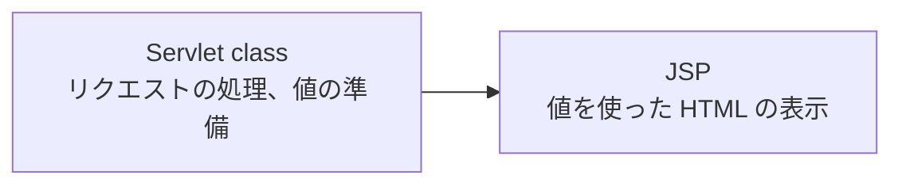

# JSP とは何か

> 疑問: JSP とは何か。
>
> 答え: HTML の中に動的な値を埋め込めるテンプレートです。Tomcat が Servlet class に変換して実行します。

## 例

JSP の中身はほぼ HTML です。`${name}` の部分に値が入ります。

```jsp
<%@ page contentType="text/html; charset=UTF-8" %>
<!DOCTYPE html>
<html lang="ja">
<body>
  <h1>こんにちは、${name}</h1>
</body>
</html>
```

JSP は Servlet とは別の仕様ですが、Tomcat で動かせます。

## 処理と表示の分担

JSP を使うと、処理と表示を分けられます。



## どの方法を使うか

| ページの内容 | 使うもの |
|---|---|
| 毎回同じ（静的） | `.html` ファイル |
| 表示だけで済む動的な内容 | JSP に直接アクセス |
| 入力チェック、DB からの取得など、表示の前に処理が必要 | Servlet class から JSP へ `forward()` |

JSP に直接アクセスするには、JSP を `WEB-INF/` の外に置きます。

```text
myapp.war
├─ hello.jsp          /myapp/hello.jsp でアクセスできる
└─ WEB-INF/
   └─ secret.jsp      直接アクセスできない
```

リクエストパラメータは `${param.name}` で読めます。

処理も JSP の中に Java コード（スクリプトレット）として書けますが、処理と表示が混ざって保守しにくくなるので、避けるのが一般的です。

## 注意点

`${name}` や `${param.name}` は自動でエスケープされません。ユーザの入力を表示するときは、[エスケープ](../04-html-response/04-xss-and-escaping.md) が必要です。

---

前: [入力値を HTML に埋め込むとなぜ危険なのか](../04-html-response/04-xss-and-escaping.md) ｜ 次: [JSP はどうやって Servlet class になるのか](02-jsp-to-servlet-class.md)
