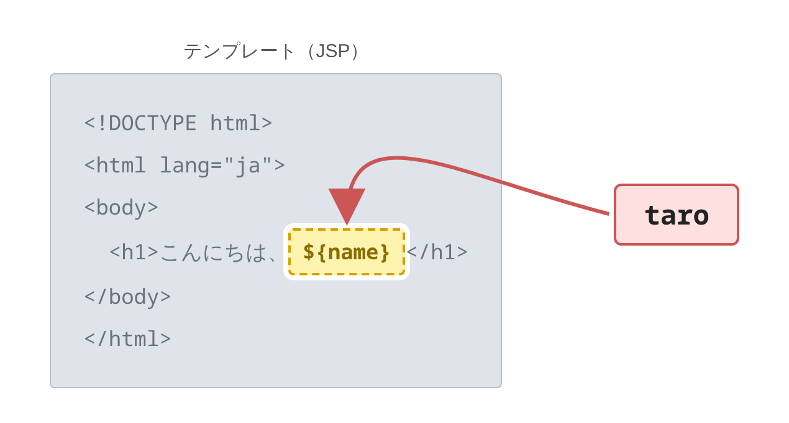

# JSP とは何か

> 疑問: Java の文字列の中に HTML を書くのは読みにくい。HTML の見た目のまま、変わる部分だけを書けないのか。
>
> 答え: JSP を使えば書けます。JSP は、HTML の中に値を入れる場所を書き込めるファイルです。

## Servlet class で HTML を書くと

[4章2節](../04-html-response/02-return-html.md) では、HTML を Java の文字列（テキストブロック）としてボディに書きました。

```java
resp.getWriter().println("""
    <!DOCTYPE html>
    <html lang="ja">
    <head><title>挨拶</title></head>
    <body>
      <h1>こんにちは、%s</h1>
    </body>
    </html>
    """.formatted(name));
```

4章2節で触れたとおり、ページが大きくなると、どこまでが HTML で、どこからが Java なのかがわかりにくくなります。

## JSP で書くと

JSP では、ファイルの中身はほとんど HTML のままです。値を入れたい場所に `${name}` と書きます。

```jsp
<%@ page contentType="text/html; charset=UTF-8" %>
<!DOCTYPE html>
<html lang="ja">
<body>
  <h1>こんにちは、${name}</h1>
</body>
</html>
```

それぞれの部分は、次のことを表します。

- `<%@ page contentType="..." %>`: Servlet class の `setContentType` と同じ指定
- `${name}`: `name` という名前の値を、ここに入れる

ファイルの名前は `hello.jsp` のように、`.jsp` で終わらせます。JSP は、Tomcat がそのまま動かしてくれます。どうやって動かしているのかは、次のページで説明します。

このように、HTML のひな形に値を入れる場所を書いておき、リクエストのたびに値を埋めて HTML を作る仕組みを、テンプレートエンジンと呼びます。JSP はその1つで、ほかに Thymeleaf や FreeMarker などがあります。[4章2節](../04-html-response/02-return-html.md) で動的ページの作り方として触れたのは、この仕組みです。

## 処理と表示を分ける

JSP を使うときは、仕事を次のように分けます。

- Servlet class: リクエストを読み、表示する値を用意する
- JSP: 用意された値を使って、HTML を作る



JSP は、HTML のひな形です。Servlet class が用意した値が、ひな形の `${name}` の場所に埋められて、HTML ができあがります。

Servlet class から JSP へ値を渡す方法は、[3節](03-forward-and-attributes.md) で説明します。

## JSP を置く場所

JSP は、`.html` ファイルと同じように、WAR の中に置くとブラウザから直接開けてしまいます。

```text
myapp.war
├─ hello.jsp          /myapp/hello.jsp で開ける
└─ WEB-INF/
   └─ secret.jsp      ブラウザからは開けない
```

`WEB-INF/` の中に置いたファイルは、ブラウザから直接は開けません。Servlet class が値を用意してから表示する JSP は、ここに置きます。直接開かれると、Servlet class を通らないので、`${name}` に入れる値が用意されないまま表示されてしまうからです。

[3節](03-forward-and-attributes.md) と [4節](04-return-html-with-jsp.md) の例でも、JSP は `WEB-INF/` に置いています。

## 気をつけること

`${name}` は、値をエスケープしません。入力された値をそのまま表示すると、[4章4節](../04-html-response/04-xss-and-escaping.md) で見た XSS の弱点になります。エスケープして表示する方法は、[4節](04-return-html-with-jsp.md) で説明します。

> コラム: なぜ JSP はリクエストできるのか
>
> 本文では、JSP は `.html` ファイルと同じように、ブラウザから直接開けると説明しました。自分で書いた Servlet class には `@WebServlet` を付けて、受け持つパスを決めました。JSP には何も付けていません。それなのに、なぜ `/myapp/hello.jsp` で開けるのでしょうか。
>
> Tomcat には、JSP を動かすための Servlet class（`JspServlet`）が、最初から入っています。この Servlet class は、Tomcat 全体の設定ファイル `conf/web.xml` で、`*.jsp` のパスを受け持つように対応付けられています。[3章1節](../03-servlet-invocation/01-url-mapping.md) の表にある、「拡張子が同じ」書き方です。
>
> そのため、`/myapp/hello.jsp` のリクエストが来ると、Tomcat はこの Servlet class を呼びます。この Servlet class が `hello.jsp` を読み、HTML を作って返します。どうやって HTML を作るのかは、次のページで説明します。
>
> 一方、`WEB-INF/` の中は、ブラウザから開けないことが Servlet 仕様で決まっています。そのため、`*.jsp` の対応付けがあっても、`WEB-INF/` の中の JSP は直接開けません。
>
> 参考: [Jasper 2 JSP Engine How To（Tomcat）](https://tomcat.apache.org/tomcat-11.0-doc/jasper-howto.html)

---

前: [5章 JSP](README.md) ｜ 次: [JSP はどうやって Servlet class になるのか](02-jsp-to-servlet-class.md)
