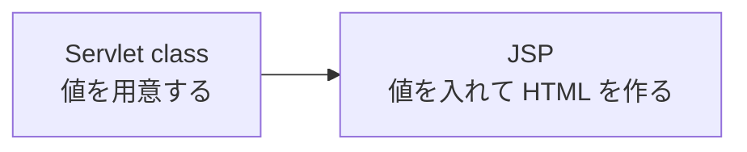

# JSP とは何か

> 疑問: Java の文字列の中に HTML を書くのは読みにくい。HTML の見た目のまま、変わる部分だけを書けないのか。
>
> 答え: JSP を使えば書けます。JSP は、HTML の中に値を入れる場所を書き込めるファイルです。

## Servlet class で HTML を書くと

4章では、HTML を Java の文字列としてボディに書きました。

```java
resp.getWriter().println("<h1>こんにちは、" + name + "</h1>");
```

ページが大きくなると、どこまでが HTML で、どこからが Java なのかがわかりにくくなります。

## JSP で書くと

JSP では、ファイルの中身はほとんど HTML のままです。値を入れたい場所に `${name}` と書きます。

```jsp
<%@ page contentType="text/html; charset=UTF-8" %>
<!DOCTYPE html>
<html lang="ja">
<body>
  <h1>こんにちは、${name}</h1>
</body>
</html>
```

それぞれの部分は、次のことを表します。

- `<%@ page contentType="..." %>`: Servlet class の `setContentType` と同じ指定
- `${name}`: `name` という名前の値を、ここに入れる

ファイルの名前は `hello.jsp` のように、`.jsp` で終わらせます。JSP は、Tomcat がそのまま動かしてくれます。

## 処理と表示を分ける

JSP を使うときは、仕事を次のように分けます。

- Servlet class: リクエストを読み、表示する値を用意する
- JSP: 用意された値を使って、HTML を作る



Servlet class から JSP へ値を渡す方法は、[Servlet class から JSP へどう処理と値を渡すのか](03-forward-and-attributes.md) で説明します。

## JSP をブラウザから直接開く

JSP は、Servlet class を通さずに、ブラウザから直接開くこともできます。

```text
myapp.war
├─ hello.jsp          /myapp/hello.jsp で開ける
└─ WEB-INF/
   └─ secret.jsp      ブラウザからは開けない
```

`WEB-INF/` の中に置いたファイルは、ブラウザから直接は開けません。Servlet class を通してだけ使いたい JSP は、ここに置きます。

直接開いた JSP では、クエリの値を `${param.name}` で読めます。`/myapp/hello.jsp?name=太郎` なら `太郎` です。

## 気をつけること

`${name}` や `${param.name}` は、値をエスケープしません。入力された値をそのまま表示すると、[XSS](../04-html-response/04-xss-and-escaping.md) の弱点になります。エスケープして表示する方法は、[JSP で HTML を返すにはどう書くのか](04-return-html-with-jsp.md) で説明します。

---

前: [入力値を HTML に埋め込むとなぜ危険なのか](../04-html-response/04-xss-and-escaping.md) ｜ 次: [JSP はどうやって Servlet class になるのか](02-jsp-to-servlet-class.md)
