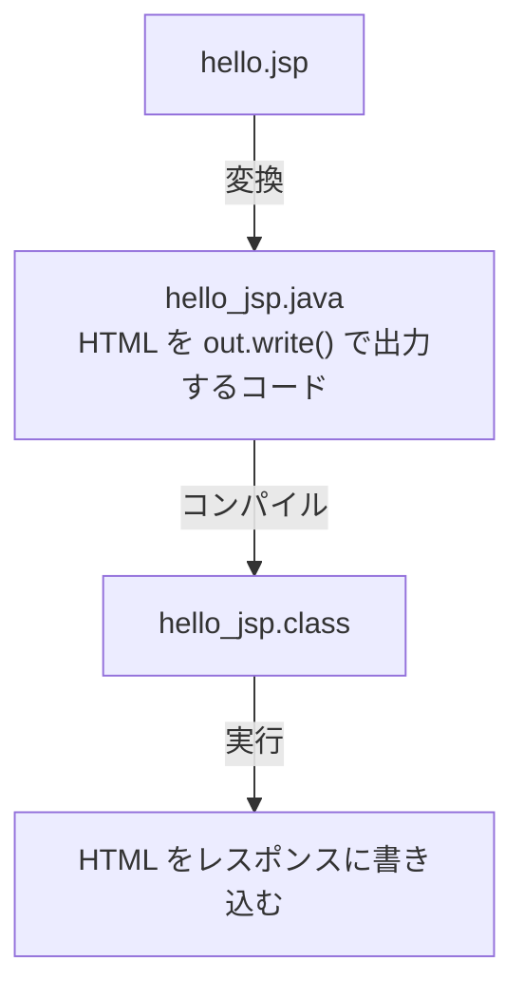

# JSP はどうやって Servlet class になるのか

> 疑問: JSP はどのように実行されるのか。
>
> 答え: Tomcat が JSP を Java コードに変換し、コンパイルして、Servlet class として実行します。

## 変換の流れ

初回のアクセス時や JSP の更新後に、変換とコンパイルが行われます。



## 変換後のコードのイメージ

次の JSP があるとします。

```jsp
<h1>こんにちは、${name}</h1>
```

変換後のコードは、概念的には次のようなものです（実際に生成されるコードはより複雑です）。

```java
out.write("<h1>こんにちは、");
out.write(/* name の値を文字列にしたもの */);
out.write("</h1>");
```

つまり、JSP は「HTML を書き出す Servlet class」を HTML の見た目のまま書くための仕組みです。`getWriter().println()` で HTML を書く処理を、Tomcat が自動で生成してくれるようなものです。

## Servlet class との共通点

JSP から作られたクラスも、Servlet class と同じようにコンテナから呼び出されます。そのため、次の点は同じです。

- `request` と `response` を受け取ってレスポンスを書き込むこと
- [1つのインスタンスを複数のスレッドが共有すること](../03-servlet-invocation/04-instance-and-threads.md)

## 自分で作るクラスとの違い

| | 自分で書く Servlet class | JSP から作られるクラス |
|---|---|---|
| 作る人 | 開発者 | Tomcat |
| URL の対応付け | `@WebServlet` など | Tomcat の標準設定で `*.jsp` に対応 |
| インスタンスの生成 | Tomcat | Tomcat |

生成されたコードは、Tomcat の `work/` ディレクトリの下で確認できます。

---

前: [JSP とは何か](01-what-is-jsp.md) ｜ 次: [Servlet class から JSP へどう処理と値を渡すのか](03-forward-and-attributes.md)
