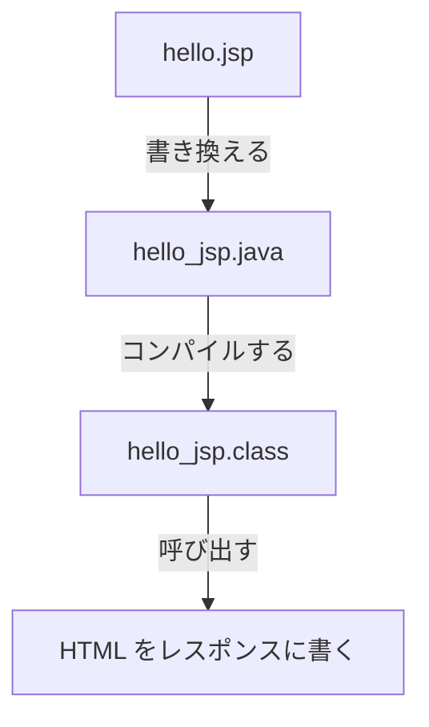

# JSP はどうやって Servlet class になるのか

> 疑問: JSP は HTML に近いファイルなのに、なぜ Tomcat で動くのか。
>
> 答え: Tomcat が JSP を Servlet class の Java コードに書き換え、コンパイルして動かすからです。

## JSP から Servlet class を作る

Tomcat は、JSP がはじめて開かれたときに、次の3つのことをします。

1. JSP を、Java のコードに書き換える
2. そのコードをコンパイルして、クラスを作る
3. できたクラスを、Servlet class として呼び出す



JSP を書き直したときは、Tomcat がもう一度書き換えてコンパイルします。

## 書き換えたコードのイメージ

次の JSP があるとします。

```jsp
<h1>こんにちは、${name}</h1>
```

Tomcat は、これをおおよそ次のようなコードに書き換えます。本物のコードはもっと複雑ですが、考え方は同じです。

```java
out.write("<h1>こんにちは、");
out.write(/* name の値 */);
out.write("</h1>");
```

`out.write` は、`resp.getWriter().println` と同じように、ボディに書くメソッドです。

つまり JSP は、4章で自分で書いていた「HTML をボディに書くコード」を、Tomcat が代わりに作ってくれるしくみです。

## Servlet class と同じところ

JSP から作られたクラスも Servlet class なので、次の点は自分で書く Servlet class と同じです。

- Tomcat がオブジェクトを作り、リクエストのたびに呼び出す
- [1つのオブジェクトを、たくさんのスレッドが同時に使う](../03-servlet-invocation/04-instance-and-threads.md)

## 自分で書く Servlet class と違うところ

- クラスを書くのは自分ではなく、Tomcat
- パスとの対応は `@WebServlet` で書かない。`.jsp` で終わるパスは、Tomcat がはじめから JSP に結び付けている

Tomcat が作った Java のコードは、Tomcat の `work/` フォルダの中で見られます。

---

前: [JSP とは何か](01-what-is-jsp.md) ｜ 次: [Servlet class から JSP へどう処理と値を渡すのか](03-forward-and-attributes.md)
