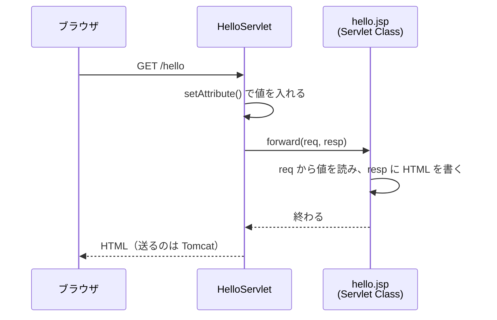

# Servlet class から JSP へどう処理と値を渡すのか

> 疑問: JSP も Servlet class になるなら、自分の Servlet class から、その JSP に処理を移すにはどうするのか。値はどうやって渡すのか。
>
> 答え: `forward()` で、処理を JSP に引き継ぎます。値は `req` に入れておきます。`forward()` は `req` を JSP にそのまま渡すので、JSP はそこから値を読めます。

## 例

`HelloServlet` が名前を用意し、`hello.jsp` が HTML を作ります。

```java
@WebServlet("/hello")
public class HelloServlet extends HttpServlet {
    @Override
    protected void doGet(HttpServletRequest req, HttpServletResponse resp)
            throws ServletException, IOException {
        req.setAttribute("name", "taro");
        req.getRequestDispatcher("/WEB-INF/hello.jsp").forward(req, resp);
    }
}
```

`WEB-INF/hello.jsp`:

```jsp
<%@ page contentType="text/html; charset=UTF-8" %>
<!DOCTYPE html>
<html lang="ja">
<body>
  <h1>こんにちは、${name}</h1>
</body>
</html>
```

`forward()` は `ServletException` を投げることがあるので、`throws` に足しています。

## 処理を JSP に引き継ぐ

`forward()` は、リクエストの処理の続きを、別の Servlet class に引き継ぐメソッドです。リレーでバトンを渡すように、`req` と `resp` を JSP に渡し、続き（レスポンスを書くこと）を JSP にさせます。JSP も、[2節](02-jsp-to-servlet-class.md) で見たとおり Servlet class になるので、引き継ぐ相手にできます。

例のコードの `req.getRequestDispatcher("/WEB-INF/hello.jsp").forward(req, resp)` は、2つのことをしています。

- `getRequestDispatcher("/WEB-INF/hello.jsp")`: 引き継ぐ相手を指定して、その相手へ送り出すためのオブジェクト（`RequestDispatcher`）を受け取る。dispatch は「送り出す」という意味
- `.forward(req, resp)`: そのオブジェクトを使って、`req` と `resp` を渡し、処理を引き継ぐ

引き継ぐ相手は、アプリの中の場所で書きます。`/myapp` のようなコンテキストパスは書きません。

- JSP は、受け取った `req` から値を読む
- JSP は、受け取った `resp` に HTML を書く



引き継ぎは Tomcat の中だけで起きます。ブラウザから見ると、リクエストは1回だけです。アドレス欄の URL も `/hello` のままです。

## 値を `req` に入れて渡す

`req.setAttribute("name", "taro")` は、`req` に「`name` という名前で `taro`」という値を置きます。JSP の `${name}` は、この値を読みます。

値を `req` に入れるのには、2つの理由があります。

1つ目は、JSP に渡せるのが `req` と `resp` だけだからです。JSP から作られたクラスのオブジェクトは Tomcat が持っていて、自分の Servlet class から直接メソッドを呼ぶことはできません。つなぐ手段は `forward()` だけで、`forward()` の引数は `req` と `resp` の2つと決まっています。そのため、渡したい値は、このどちらかに載せるしかありません。

2つ目は、`req` が、1回のリクエストの間だけ値を置いておく場所だからです。`req` は、届いたリクエストの情報を読むためのオブジェクトですが、`setAttribute` で、自分で名前を付けた値を置くこともできます。`req` はリクエストごとに作られ、レスポンスを返すと捨てられます。そのため、置いた値はこのリクエストの中だけで使われ、他の人のリクエストと混ざりません。Servlet class のフィールドに置くと、[3章4節](../03-servlet-invocation/04-instance-and-threads.md) で見たように、他の人の値と混ざってしまいます。

## 名前のまちがいに気づきにくい

`setAttribute` で入れる値の名前は、ただの文字列です。`setAttribute("name", ...)` と書いたのに、JSP で `${nmae}` とまちがえても、エラーになりません。何も表示されないだけです。

値が表示されないときは、まず名前のつづりを確かめてください。

## 気をつけること

- `forward()` の前に、ボディを書かない。書いた中身は捨てられる。レスポンスを送ってから JSP に処理を移せばエラーになる
- `forward()` のあとに、ボディを書かない。JSP が書き終わった時点で、レスポンスは送られている

送り始めるタイミングは、[4章3節](../04-html-response/03-response-commit.md) で説明しました。

> コラム: 引き継ぐ相手のパスの考え方
>
> `getRequestDispatcher` に渡すパスは、「そのパスを誰が読むか」で考えるとわかりやすくなります。
>
> このパスを読むのは Tomcat で、ブラウザには届きません。Tomcat は、すでに `myapp.war` の中でリクエストを処理しているので、どのアプリかはもうわかっています。そのため、パスにはアプリの中の場所だけを書きます。先頭の `/` は、WAR ファイルのいちばん上を表します。
>
> ```text
> myapp.war                ← "/" はここ
> ├─ hello.jsp             "/hello.jsp"
> └─ WEB-INF/
>    └─ hello.jsp          "/WEB-INF/hello.jsp"
> ```
>
> `WEB-INF/` の中は、ブラウザからは開けませんが、ここでは指定できます。読むのが Tomcat だからです。
>
> 相手には、JSP のファイルだけでなく、`@WebServlet` で決めたパスも指定できます。たとえば `"/hello"` と書くと、`/hello` を受け持つ Servlet class に引き継ぎます。
>
> 一方、ブラウザが読むパスには、コンテキストパスが要ります。ブラウザはアプリの外にいて、どのアプリかを URL で伝える必要があるからです。[6章4節](../06-input-and-redirect/04-what-is-redirect.md) のリダイレクトでは、ブラウザに開き直してほしい URL を渡すので、`req.getContextPath()` でコンテキストパスを付けます。

---

前: [JSP はどうやって Servlet class になるのか](02-jsp-to-servlet-class.md) ｜ 次: [JSP で HTML を返すにはどう書くのか](04-return-html-with-jsp.md)
