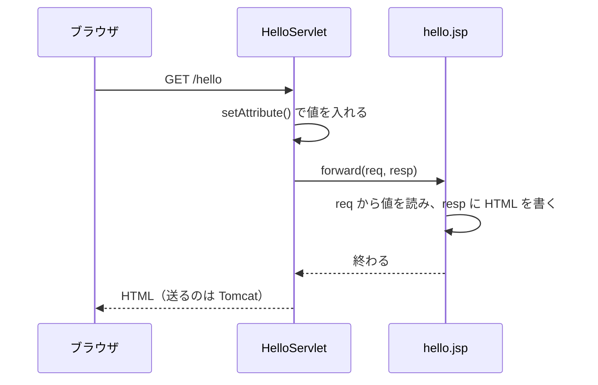

# Servlet class から JSP へどう処理と値を渡すのか

> 疑問: Servlet class で用意した値を、JSP でどうやって使うのか。
>
> 答え: 値を `req.setAttribute()` で `req` に入れ、`forward()` で JSP に処理を引き継ぎます。JSP は、引き継いだ `req` から値を読みます。

## 例

`HelloServlet` が名前を用意し、`hello.jsp` が HTML を作ります。

```java
@WebServlet("/hello")
public class HelloServlet extends HttpServlet {
    @Override
    protected void doGet(HttpServletRequest req, HttpServletResponse resp)
            throws ServletException, IOException {
        req.setAttribute("name", "太郎");
        req.getRequestDispatcher("/WEB-INF/hello.jsp").forward(req, resp);
    }
}
```

`WEB-INF/hello.jsp`:

```jsp
<%@ page contentType="text/html; charset=UTF-8" %>
<!DOCTYPE html>
<html lang="ja">
<body>
  <h1>こんにちは、${name}</h1>
</body>
</html>
```

`forward()` は `ServletException` を投げることがあるので、`throws` に足しています。

## 値を `req` に入れる

`req.setAttribute("name", "太郎")` は、`req` に「`name` という名前で `太郎`」という値を入れます。JSP の `${name}` は、この値を読みます。

`req` に値を入れるのは、`req` がリクエストごとに別のオブジェクトだからです。たくさんの人が同時に開いても、値が他の人のものと混ざりません。

## 処理を JSP に引き継ぐ

`forward()` は、処理を JSP に引き継ぐメソッドです。引き継ぐときに、`req` と `resp` をそのまま渡します。

- JSP は、受け取った `req` から値を読む
- JSP は、受け取った `resp` に HTML を書く



引き継ぎは Tomcat の中だけで起きます。ブラウザから見ると、リクエストは1回だけです。アドレス欄の URL も `/hello` のままです。

## 引数で渡さない理由

`forward()` の引数は、`req` と `resp` の2つと決まっています。他の値を引数として足すことはできません。

そのため、渡したい値は `req` に入れて、`req` ごと渡します。

## 名前のまちがいに気づきにくい

`setAttribute` で入れる値の名前は、ただの文字列です。`setAttribute("name", ...)` と書いたのに、JSP で `${nmae}` とまちがえても、エラーになりません。何も表示されないだけです。

値が表示されないときは、まず名前のつづりを確かめてください。

## 気をつけること

- `getRequestDispatcher` のパスは、アプリの中の場所で書く。`/myapp` のようなコンテキストパスは書かない
- `forward()` の前に、ボディを書かない。書いた中身は捨てられる。送り始めていたら、エラーになる
- `forward()` のあとに、ボディを書かない。JSP が書き終わった時点で、レスポンスは送られている

---

前: [JSP はどうやって Servlet class になるのか](02-jsp-to-servlet-class.md) ｜ 次: [JSP で HTML を返すにはどう書くのか](04-return-html-with-jsp.md)
