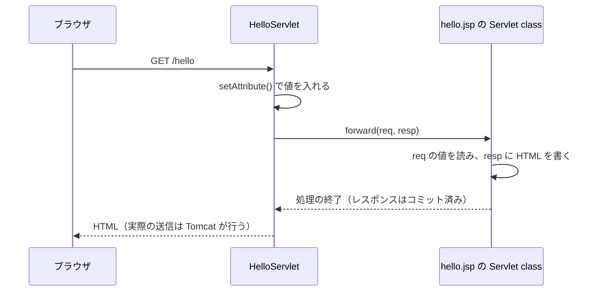

# Servlet class から JSP へどう処理と値を渡すのか

> 疑問: Servlet class から JSP へ、処理と値をどう渡すのか。
>
> 答え: 値は `req.setAttribute()` で `request` に入れ、処理は `forward()` で渡します。

## 例

```java
@WebServlet("/hello")
public class HelloServlet extends HttpServlet {
    @Override
    protected void doGet(HttpServletRequest req, HttpServletResponse resp)
            throws ServletException, IOException {
        req.setAttribute("name", "太郎");
        req.getRequestDispatcher("/WEB-INF/hello.jsp").forward(req, resp);
    }
}
```

`WEB-INF/hello.jsp`:

```jsp
<%@ page contentType="text/html; charset=UTF-8" %>
<!DOCTYPE html>
<html lang="ja">
<body>
  <h1>こんにちは、${name}</h1>
</body>
</html>
```

## 処理の流れ



`forward()` はサーバ内の処理なので、ブラウザから見ると1回のリクエストです。ブラウザの URL は `/hello` のままです。

## `forward()` の引数

`forward()` の引数は `req` と `resp` の2つに固定されています。

```java
void forward(ServletRequest request, ServletResponse response)
```

| 引数 | 転送先での使われ方 |
|---|---|
| `req` | パラメータや `setAttribute()` で入れた値を読む |
| `resp` | HTML を書き込む |

独自の引数は追加できないので、渡したい値は `req` に入れます。JSP から作られるクラスは Tomcat が生成して管理するので、自分のコードから直接 `new` して呼び出すこともしません。

## `setAttribute()` の特徴

`request` はリクエストごとに別のオブジェクトなので、同時に複数のリクエストを処理していても、他のユーザの値と混ざりません。値はそのリクエストの処理の間だけ使えます。

一方、引数と違って名前や型がコンパイル時にチェックされません。`setAttribute("name", ...)` と書いたのに JSP で `${nmae}` と書いても、エラーにならず空文字が表示されます。

## 注意点

- パスの基準: `/` で始まるパスはアプリのルートからの位置です。コンテキストパスは含めません。
- `forward()` の前に本文を書かない: バッファに書いた本文は `forward()` の時点で破棄されます。すでに送信が始まっていれば `IllegalStateException` になります。ステータスやヘッダーは引き継がれます。
- `forward()` の後にレスポンスを書かない: 転送先の処理が終わり、`forward()` が戻る前にレスポンスはコミットされて閉じられます。
- 例外の宣言: `forward()` は `ServletException` を投げる可能性があるので、`throws` に追加します。

---

前: [JSP はどうやって Servlet class になるのか](02-jsp-to-servlet-class.md) ｜ 次: [JSP で HTML を返すにはどう書くのか](04-return-html-with-jsp.md)
