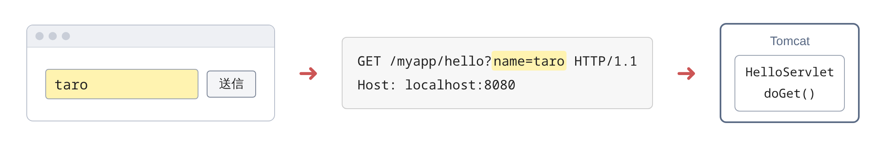

# ユーザの入力をどう受け取るのか

> 疑問: フォームに入力された値を、Servlet class でどうやって受け取るのか。
>
> 答え: `GET` でも `POST` でも、`req.getParameter()` で読みます。`POST` で日本語を受け取るときは、読む前に文字コードを指定します。

この章では、果物を追加して一覧を見るアプリを作ります（[6章の表紙](README.md)）。このページでは、その入口として、フォームから入力を受け取る方法を見ます。

## フォームと `name` 属性

HTML のフォームは、入力された値をリクエストに入れて送ります。

```html
<form method="get" action="/myapp/hello">
  <input type="text" name="name">
  <button type="submit">送信</button>
</form>
```

このフォームに `taro` と入力して送信すると、入力した値がリクエストに入って、Servlet class に届きます。



`action` には、送り先のパスを書きます。このパスを読むのはブラウザなので、コンテキストパス（`/myapp`）から書きます（[5章3節](../05-jsp/03-forward-and-attributes.md) ）。

`<input>` の `name` 属性が、値の名前になります。Servlet class では、この名前を `getParameter()` に渡して値を読みます。

```java
String name = req.getParameter("name");
```

フォームは、`method` 属性で、`GET` と `POST` のどちらで送るかを選びます。`GET` は「ページをください」と頼むとき、`POST` は「このデータで処理をして」と頼むときの HTTP メソッドでしたね（[1章4節](../01-web-basics/04-what-is-http.md)）。Servlet class では、`GET` なら `doGet`、`POST` なら `doPost` が呼ばれます（[3章3節](../03-servlet-invocation/03-service-dispatch.md)）。

## `GET` で送ると

`method="get"` のフォームに `taro` と入力して送る場合、値は URL のクエリに入ります。

```text
GET /myapp/hello?name=taro HTTP/1.1
```

Servlet class では、`doGet` で受け取ります。

```java
@Override
protected void doGet(HttpServletRequest req, HttpServletResponse resp) throws IOException {
    String name = req.getParameter("name");
    // ...
}
```

## `POST` で送ると

`method="post"` にすると、値は URL ではなく、リクエストのボディに入ります。ここでは、果物を追加するフォームを例にします。

```html
<form method="post" action="/myapp/fruits">
  <input type="text" name="fruit">
  <button type="submit">追加</button>
</form>
```

`りんご` と入力して送ると、次のリクエストになります。日本語は、URL のクエリと同じように、`%` を使った形に置き換えて送られます。

```text
POST /myapp/fruits HTTP/1.1
Content-Type: application/x-www-form-urlencoded

fruit=%E3%82%8A%E3%82%93%E3%81%94
```

Servlet class では、`doPost` で受け取ります。読み方は `GET` と同じ `getParameter()` です。

```java
@Override
protected void doPost(HttpServletRequest req, HttpServletResponse resp) throws IOException {
    req.setCharacterEncoding("UTF-8");   // 値を読む前に書く
    String fruit = req.getParameter("fruit");
    // ...
}
```

## `POST` では文字コードを指定する

`POST` のボディに入った日本語を正しく読むには、`req.setCharacterEncoding("UTF-8")` で文字コードを指定します。指定しないと、日本語が読めない文字に化けることがあります。

この指定は、`getParameter()` で値を読む前に書きます。読んだあとに指定しても効きません。

`GET` では、この指定は要りません。2つの違いは、値がどこに入るかにあります。

- `GET` の値は URL に入る。[1章3節](../01-web-basics/03-what-is-url.md) で見たとおり、URL では日本語を `%E5…` のような文字に置き換えて送る。Tomcat は、それを UTF-8 として元に戻す
- `POST` の値はボディに入る。ブラウザは、ボディを何の文字コードで書いたかを、リクエストに書かないことが多い。そのとき Servlet は、日本語を含まない古い文字コード（ISO-8859-1）で書かれたものとみなして読むと決まっている。そのため、自分で UTF-8 と指定する

## `GET` と `POST` の使い分け

- `GET`: 値を使って、ページを見るだけのとき。検索など
- `POST`: 値を使って、何かを変えるとき。登録や追加など

1章4節で見たとおり、`GET` は「ページをください」、`POST` は「このデータで処理をして」という頼み方でした。見るだけなら `GET`、サーバに何かを変えてもらうなら `POST` と、頼みたいことに合わせて選びます。

この章で作るアプリでは、次のように使い分けます。

- 果物の一覧を見る: 見るだけなので `GET`
- 果物を追加する: リストを変えるので `POST`

そのため、果物を追加するフォームは、「`POST` で送ると」の項で見たとおり `method="post"` にします。

## 気をつけること

- `getParameter()` は、値がないと `null` を返す。使う前に確かめる
- 入力された値を HTML に表示するときは、エスケープする。Servlet class では [4章4節](../04-html-response/04-xss-and-escaping.md) の `escapeHtml`、JSP では [5章4節](../05-jsp/04-return-html-with-jsp.md) の `<c:out>` を使う

これで、フォームから果物の名前を受け取れるようになりました。次のページでは、受け取った名前を確かめて、果物のリストに追加します。

> コラム: フォーム以外のデータを受け取る
>
> `POST` のボディには、ふつうのフォーム以外の形のデータが入ることもあります。形によって、読み方が変わります。
>
> - ふつうのフォーム: `req.getParameter()` で読む
> - ファイルを送るフォーム: `req.getPart()` で読む。Servlet class に `@MultipartConfig` を付ける
> - JSON などのデータ: `req.getReader()` でボディの文字をそのまま読み、自分で読み取る
>
> ボディは、基本的に1回しか読めません。`getReader()` で読んだあとに `getParameter()` を呼んでも、値は取れません。
>
> この教材では、ふつうのフォームだけを使います。

---

前: [6章 入力を受け取り、結果を返す](README.md) ｜ 次: [受け取った値をどう処理するのか](02-process-input.md)
