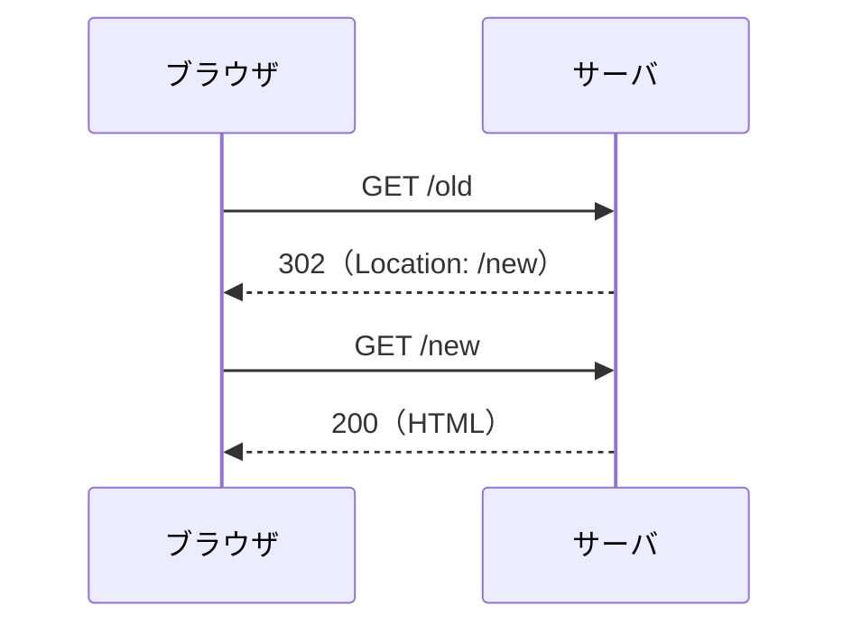
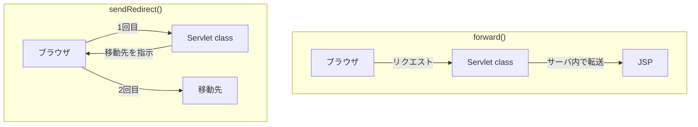

# リダイレクトとは何か

> 疑問: リダイレクトとは何か。
>
> 答え: サーバがブラウザに「別の URL にアクセスし直して」と伝える仕組みです。ブラウザは指定された URL へ自動で新しいリクエストを送ります。

## 流れ



リダイレクトのレスポンスでは、ステータスコードで「リダイレクトであること」を伝え、`Location` ヘッダーで移動先を伝えます。

## Servlet class での書き方

```java
resp.sendRedirect(req.getContextPath() + "/fruits");
```

リダイレクト先はブラウザが解釈する URL なので、`getContextPath()` でコンテキストパス（`/myapp` など）を含めます。

`sendRedirect()` を呼ぶとレスポンスはコミットされます。後続の処理がある場合は、`return` で抜けます。

## `forward()` との違い



| | `forward()` | `sendRedirect()` |
|---|---|---|
| 実行される場所 | サーバ内 | ブラウザが新しいリクエストを送る |
| HTTP リクエストの回数 | 1回 | 2回 |
| ブラウザの URL | 変わらない | 移動先に変わる |
| `setAttribute()` の値 | 引き継がれる | 引き継がれない |
| パスの基準 | アプリのルート（コンテキストパスは含めない） | ブラウザが解釈する URL |
| 移動先 | 同じサーバ内 | 外部のサイトも指定できる |

## 主なステータスコード

| コード | 意味 | 次のリクエストのメソッド |
|---|---|---|
| 301 | 恒久的な移動 | POST が GET に変わることがある |
| 302 | 一時的な移動 | POST が GET に変わることがある |
| 303 | 別の URL を GET で参照する | GET |
| 307 | 一時的な移動 | 同じメソッドを維持する |
| 308 | 恒久的な移動 | 同じメソッドを維持する |

`sendRedirect()` は通常 302 を送ります。一般的なブラウザは、POST への 302 に対して次のリクエストを GET にします。

---

前: [ユーザの入力をどう受け取るのか](01-receive-user-input.md) ｜ 次: [POST の二重送信をどう防ぐのか](03-prg-pattern.md)
