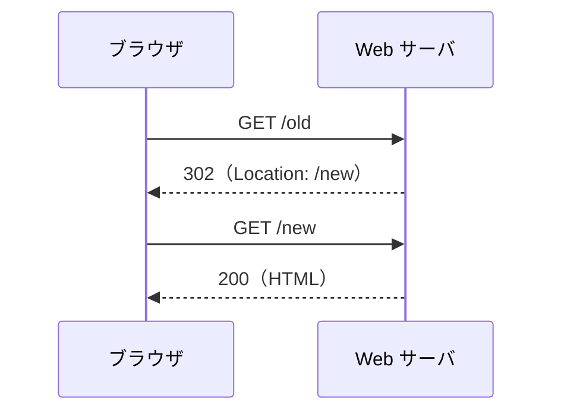
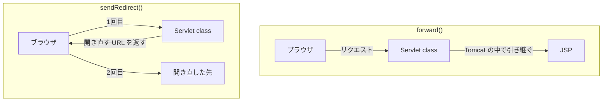

# リダイレクトとは何か

> 疑問: 古い URL を開いた人を、新しい URL のページへ案内するにはどうすればよいのか。
>
> 答え: リダイレクトを使います。Web サーバがブラウザに「この URL を開き直して」と返事をすると、ブラウザがその URL を自動で開きます。

## リダイレクトの流れ

リダイレクトでは、ブラウザが2回リクエストを送ります。



1回目のレスポンスには、ボディの代わりに次の2つが入っています。

- ステータスコード `302`: 「別の URL を見てほしい」という意味
- `Location` ヘッダー: 開き直してほしい URL

ブラウザはこれを見て、`Location` の URL へ2回目のリクエストを送ります。アドレス欄の URL も、新しい URL に変わります。

## Servlet class での書き方

`resp.sendRedirect()` に、開き直してほしい URL を渡します。

```java
resp.sendRedirect(req.getContextPath() + "/fruits");
```

`req.getContextPath()` は、`/myapp` のようなコンテキストパスを返します。リダイレクト先の URL はブラウザが開くので、コンテキストパスから書く必要があります。

`sendRedirect()` を呼ぶと、レスポンスを送り始めます。そのあとに処理を続けないよう、必要なら `return` で `doGet` を抜けます。

## `forward()` との違い

5章の `forward()` も、別の場所に処理を任せるしくみでした。2つは、任せる相手が違います。

- `forward()`: Tomcat の中で、JSP に処理を引き継ぐ。ブラウザは気づかない
- `sendRedirect()`: ブラウザに、別の URL を開き直してもらう



この違いから、次の違いが生まれます。

| 比べること | `forward()` | `sendRedirect()` |
|---|---|---|
| リクエストの回数 | 1回 | 2回 |
| アドレス欄の URL | 変わらない | 新しい URL に変わる |
| `setAttribute()` で入れた値 | 引き継がれる | 引き継がれない |
| パスの書き方 | コンテキストパスを書かない | コンテキストパスから書く |
| 行き先 | 同じアプリの中だけ | 他のサイトも指定できる |

`setAttribute()` の値が引き継がれないのは、2回目が別のリクエストで、`req` も新しく作られるからです。

## リダイレクトのステータスコード

リダイレクトのステータスコードには、`302` の他にもいくつかあります。

- `301`: URL がずっと変わった。サイトの引っ越しなどに使う
- `302`: 今だけ別の URL を見てほしい。`sendRedirect()` はこれを返す
- `303`: 別の URL を `GET` で開いてほしい

ブラウザは、`POST` への `302` を受け取ると、2回目のリクエストを `GET` で送ります。次のファイルでは、このふるまいを使います。

---

前: [ユーザの入力をどう受け取るのか](01-receive-user-input.md) ｜ 次: [POST の二重送信をどう防ぐのか](03-prg-pattern.md)
