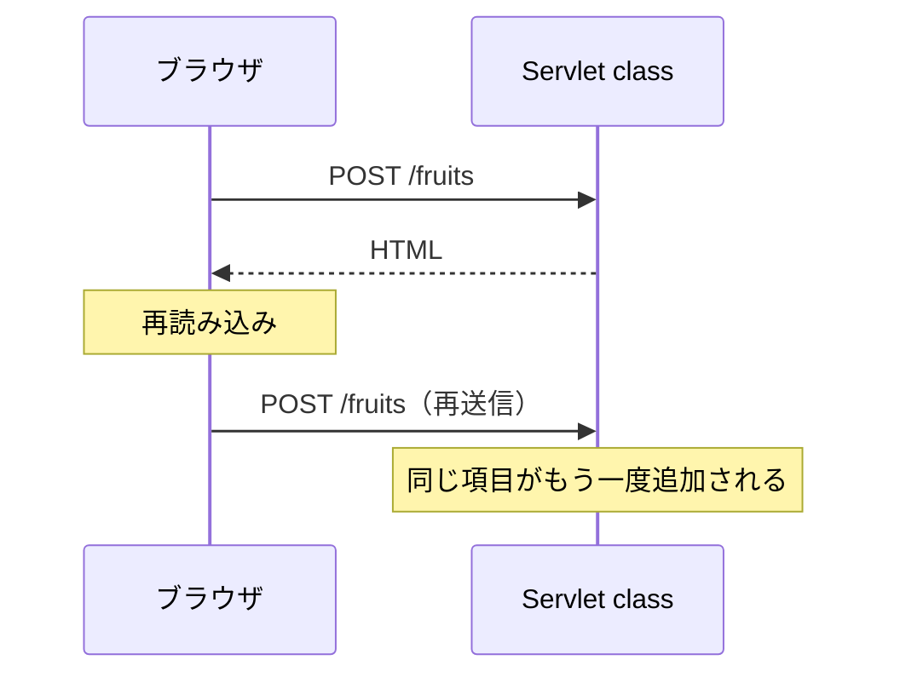
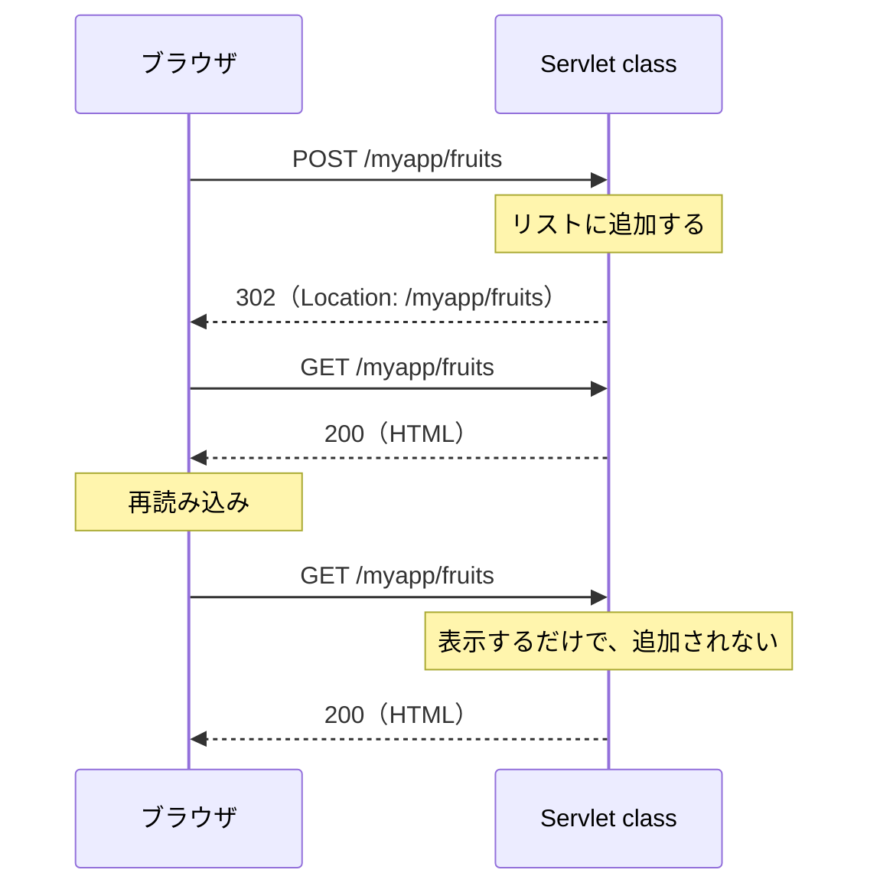

# POST の二重送信をどう防ぐのか

> 疑問: POST の結果を表示したページを再読み込みすると、同じ処理が繰り返されないか。
>
> 答え: POST の結果をそのまま表示すると、再読み込みで再送信されることがあります。更新後にリダイレクトして GET で表示する PRG（Post/Redirect/Get）パターンで防ぎます。

## 問題

通常のフォーム送信では、ブラウザはレスポンスの HTML でページ全体を描画し直します。そのレスポンスを `forward()` で返すと、再読み込みが同じ POST の再送信になります（通常はブラウザが確認を出します）。リストへの追加なら、同じ項目が二重に追加されるかもしれません。



## PRG パターン



ブラウザの現在のページは GET の結果になるので、再読み込みしても POST は再送信されません。

## 実装例

Servlet class:

```java
@WebServlet("/fruits")
public class FruitServlet extends HttpServlet {
    // 全リクエストで共有するので、スレッドセーフなリストを使う
    private final List<String> fruits = new CopyOnWriteArrayList<>();

    // 表示だけを担当する
    @Override
    protected void doGet(HttpServletRequest req, HttpServletResponse resp)
            throws ServletException, IOException {
        req.setAttribute("fruits", fruits);
        req.getRequestDispatcher("/WEB-INF/fruits.jsp").forward(req, resp);
    }

    // 更新だけを担当し、HTML は返さない
    @Override
    protected void doPost(HttpServletRequest req, HttpServletResponse resp) throws IOException {
        req.setCharacterEncoding("UTF-8");

        String name = req.getParameter("name");
        if (name != null && !name.isBlank()) {
            fruits.add(name);
        }

        resp.sendRedirect(req.getContextPath() + "/fruits");
    }
}
```

`WEB-INF/fruits.jsp`（[JSTL](../05-jsp/04-return-html-with-jsp.md) が必要です）:

```jsp
<%@ page contentType="text/html; charset=UTF-8" %>
<%@ taglib prefix="c" uri="jakarta.tags.core" %>
<!DOCTYPE html>
<html lang="ja">
<body>
  <form method="post" action="${pageContext.request.contextPath}/fruits">
    <input type="text" name="name">
    <button type="submit">追加</button>
  </form>

  <ul>
    <c:forEach var="fruit" items="${fruits}">
      <li><c:out value="${fruit}" /></li>
    </c:forEach>
  </ul>
</body>
</html>
```

## ポイント

- `setAttribute()` の値は引き継がれない: リダイレクトの前後は別のリクエストです。表示に必要な値は `doGet()` で用意します。
- 防げるのは再読み込みによる再送信: ボタンの連打など、POST 自体が複数回送られる場合は別の対策が必要です。

## この例の制限

リストは Servlet class のインスタンス変数に持っているので、次の制限があります。

- 全ユーザで同じリストを共有します。
- Tomcat の再起動やアプリの再デプロイで消えます。

実際のアプリでは、DB などに保存するのが一般的です。

## 補足: ページ遷移を避ける場合

JavaScript の `fetch()` で POST を送ると、ページ全体を描画し直さず、変わった部分だけを画面に反映できます。Tomcat と Servlet class から見ると、どちらも同じ HTTP リクエストです。違いは、レスポンスを受け取ったブラウザ側の扱いです。

---

前: [リダイレクトとは何か](02-what-is-redirect.md) ｜ [目次に戻る](../README.md)
