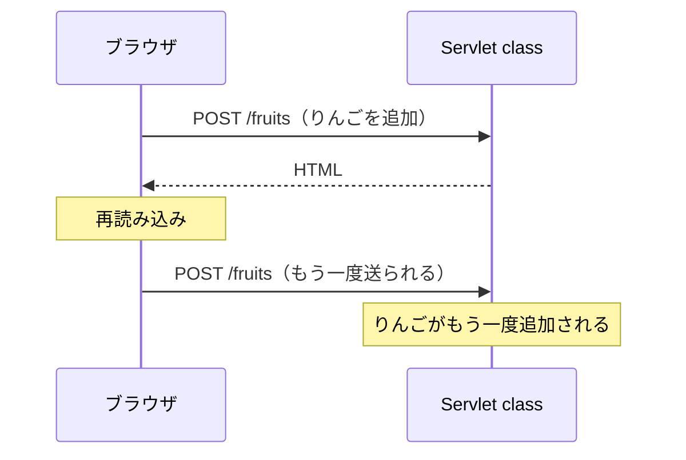
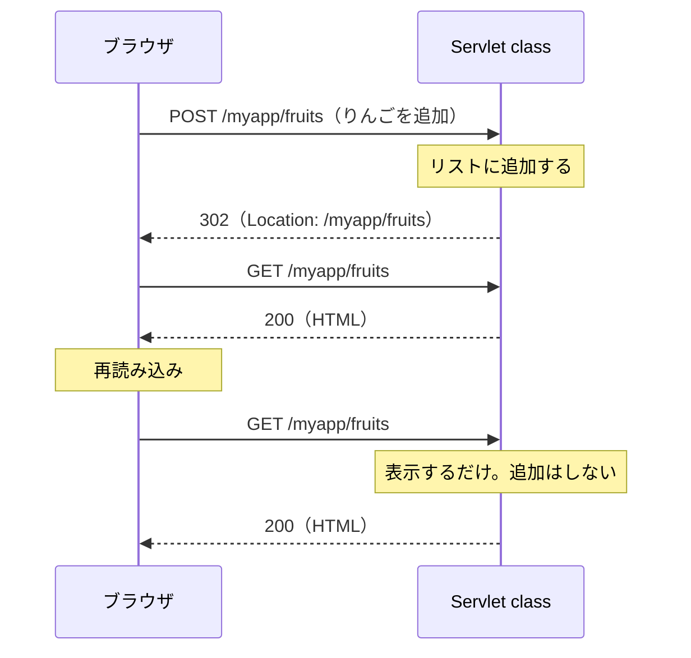

# POST の二重送信をどう防ぐのか

> 疑問: フォームで果物を追加したあと、ページを再読み込みしたら、同じ果物がもう一度追加されないか。
>
> 答え: `POST` の返事として HTML を返すと、追加されることがあります。`POST` の返事ではリダイレクトして、`GET` で開き直したページを表示すれば防げます。

## 再読み込みは、最後のリクエストを送り直す

ブラウザの再読み込みは、今のページを表示したときのリクエストを、もう一度送ります。

`POST` の返事として HTML を返すと、今のページは `POST` の結果になります。この状態で再読み込みすると、同じ `POST` がもう一度送られます。たいていのブラウザは「もう一度送信しますか」と確認しますが、そのまま進むと同じ果物がもう一度追加されます。



## 追加したあとはリダイレクトする

`POST` の返事では HTML を返さず、リダイレクトします。ブラウザは `GET` で開き直すので、今のページは `GET` の結果になります。



再読み込みで送り直されるのは `GET` なので、表示されるだけで、追加はされません。

この書き方を、`POST` → リダイレクト → `GET` の頭文字をとって、PRG（Post/Redirect/Get）パターンと呼びます。

## 例

`doGet` は表示だけ、`doPost` は追加だけを受け持ちます。

Servlet class:

```java
@WebServlet("/fruits")
public class FruitServlet extends HttpServlet {
    // 全部のリクエストで共有するので、同時に使っても壊れないリストを使う
    private final List<String> fruits = new CopyOnWriteArrayList<>();

    // 表示だけを受け持つ
    @Override
    protected void doGet(HttpServletRequest req, HttpServletResponse resp)
            throws ServletException, IOException {
        req.setAttribute("fruits", fruits);
        req.getRequestDispatcher("/WEB-INF/fruits.jsp").forward(req, resp);
    }

    // 追加だけを受け持ち、HTML は返さない
    @Override
    protected void doPost(HttpServletRequest req, HttpServletResponse resp) throws IOException {
        req.setCharacterEncoding("UTF-8");

        String name = req.getParameter("name");
        if (name != null && !name.isBlank()) {
            fruits.add(name);
        }

        resp.sendRedirect(req.getContextPath() + "/fruits");
    }
}
```

`fruits` は、全部のリクエストで共有するフィールドです。[同時に使うと値が混ざる問題](../03-servlet-invocation/04-instance-and-threads.md) を防ぐため、`ArrayList` ではなく `CopyOnWriteArrayList` を使っています。

`WEB-INF/fruits.jsp`（[JSTL](../05-jsp/04-return-html-with-jsp.md) を使います）:

```jsp
<%@ page contentType="text/html; charset=UTF-8" %>
<%@ taglib prefix="c" uri="jakarta.tags.core" %>
<!DOCTYPE html>
<html lang="ja">
<body>
  <form method="post" action="${pageContext.request.contextPath}/fruits">
    <input type="text" name="name">
    <button type="submit">追加</button>
  </form>

  <ul>
    <c:forEach var="fruit" items="${fruits}">
      <li><c:out value="${fruit}" /></li>
    </c:forEach>
  </ul>
</body>
</html>
```

`${pageContext.request.contextPath}` は、JSP の中で `req.getContextPath()` と同じ値を読む書き方です。

## 気をつけること

- 表示に使う値は、`doGet` で用意する。リダイレクトの前に `setAttribute()` で入れた値は、2回目のリクエストには届かない
- PRG パターンで防げるのは、再読み込みによる送り直しだけ。送信ボタンを何度も押されたときは、別の対策がいる

## この例の限界

この例では、リストを Servlet class のフィールドに入れています。そのため、次の限界があります。

- 全員が同じ1つのリストを使う
- Tomcat を止めると、リストは消える

本物のアプリでは、データベースなどに保存します。

---

## 参考文献

この章では、わかりやすさを優先して説明を単純にしています。正確な仕組みや、さらに詳しい内容は次の資料で学べます。

フォームとリダイレクト:

- [フォームデータの送信（MDN）](https://developer.mozilla.org/ja/docs/Learn_web_development/Extensions/Forms/Sending_and_retrieving_form_data)
- [`<form>` 要素（MDN）](https://developer.mozilla.org/ja/docs/Web/HTML/Reference/Elements/form)
- [HTTP のリダイレクト（MDN）](https://developer.mozilla.org/ja/docs/Web/HTTP/Guides/Redirections)
- [Post/Redirect/Get（Wikipedia 英語版）](https://en.wikipedia.org/wiki/Post/Redirect/Get)

Servlet 仕様の該当する章:

- [Jakarta Servlet 6.1 仕様: HTTP Protocol Parameters（`getParameter()` で読める値）](https://jakarta.ee/specifications/servlet/6.1/jakarta-servlet-spec-6.1.html#http-protocol-parameters)
- [Jakarta Servlet 6.1 仕様: Convenience Methods（`sendRedirect()` など）](https://jakarta.ee/specifications/servlet/6.1/jakarta-servlet-spec-6.1.html#convenience-methods)

リダイレクトのステータスコードの正式な決まり:

- [RFC 9110: HTTP Semantics](https://www.rfc-editor.org/rfc/rfc9110)

次のステップ:

- [Jakarta EE Tutorial](https://jakarta.ee/learn/docs/jakartaee-tutorial/current/index.html)。Servlet 以外の Jakarta EE の技術も、順に学べる

---

前: [リダイレクトとは何か](02-what-is-redirect.md) ｜ [目次に戻る](../README.md)
