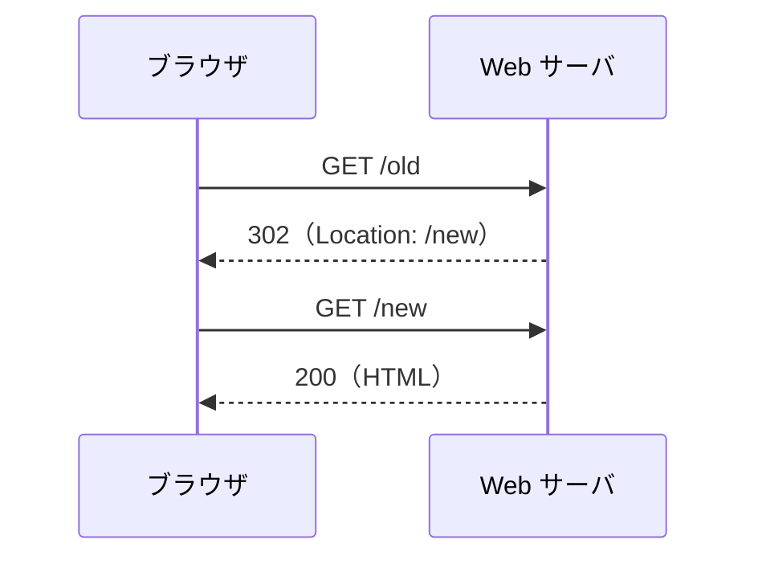

# リダイレクトとは何か

> 疑問: 果物を追加したあとのページを、ふつうのページのように再読み込みできないのか。
>
> 答え: できます。追加したあと、 `GET` でリクエストし直せばよいのです。表示されるのは 果物の一覧ページです。再読み込みしても、送り直されるのは `GET` リクエストなので、果物は追加されません。これを行うためのよい方法が、リダイレクトです。

## リダイレクトとは

リダイレクトは、Web サーバがブラウザに「別の URL にリクエストを送り直してください」と返事をして、ブラウザにその URL へもう一度リクエストを送ってもらう仕組みです。ブラウザは、この返事を受け取ると、自分でその URL へリクエストを送ります。ユーザが何かをする必要はありません。

たとえば、サイトの引っ越しで URL が変わったとき、古い URL にアクセスした人を、新しい URL へ案内するのに使われます。打ち込んだ URL と、表示されたページのアドレス欄の URL が違っていたら、リダイレクトされたのかもしれません。

リダイレクトは、HTTP の仕組みです。Tomcat や Servlet が決めたものではないので、どの Web サーバでも同じように使えます。

## リダイレクトの流れ

ふつうのレスポンスでは、Web サーバはステータスコード `200` と、ボディに HTML を入れて返します。ブラウザは、その HTML を表示します。リクエストは1回で、アドレス欄には、リクエストを送った URL が表示されます。

リダイレクトのレスポンスは、これと違います。次の図は、古い URL（`/old`）にアクセスした人を、新しい URL（`/new`）へ案内する例です。



1回目のレスポンスには、表示する HTML の代わりに、次の2つが入っています。

- ステータスコード `302`: 「別の URL を見てほしい」という意味
- `Location` ヘッダー: 次にリクエストを送ってほしい URL

ブラウザは、このレスポンスを表示しません。代わりに、`Location` の URL へ2回目のリクエストを送り、その返事（`200` と HTML）を表示します。アドレス欄の URL も、2回目にリクエストを送った URL に変わります。

2回目は、1回目とは別の、新しいリクエストです。Tomcat は、2回目のために `req` と `resp` を新しく作ります。そのため、1回目の処理で `setAttribute()` を使って `req` に入れた値は、2回目には届きません。

## Servlet class での書き方

`resp.sendRedirect()` に、リダイレクト先の URL を渡します。

```java
resp.sendRedirect(req.getContextPath() + "/fruits");
```

`sendRedirect()` は、ステータスコード `302` と `Location` ヘッダーを、まとめて書いてくれるメソッドです。自分で書くと、次の2行とほぼ同じです。

```java
resp.setStatus(302);
resp.setHeader("Location", req.getContextPath() + "/fruits");
```

`req.getContextPath()` は、`/myapp` のようなコンテキストパスを返します。リダイレクト先の URL を読むのはブラウザなので、コンテキストパスから書きます。

`sendRedirect()` を呼ぶと、レスポンスを送り始めます。そのあとに処理を続けないよう、必要なら `return` で `doGet` を抜けます。

## リダイレクトのステータスコード

HTTP の仕様では、リダイレクトのステータスコードを、次のように決めています。ステータスコードには、数字と一緒に短い名前が付いています。

- `301 Moved Permanently`: 別の URL へ移った。サイトの引っ越しなどに使う
- `302 Found`: 一時的に、別の URL にある。`sendRedirect()` はこれを返す
- `303 See Other`: リクエストの結果は、別の URL にある。その URL へは `GET` でリクエストを送る
- `307 Temporary Redirect`: `302` と同じく一時的。ただし、2回目も同じメソッドで送る
- `308 Permanent Redirect`: `301` と同じくずっと。ただし、2回目も同じメソッドで送る

`POST` への `301` や `302` を受け取ると、ブラウザは、2回目のリクエストを `GET` で送ります。これは、昔からのブラウザの動きで、仕様もこれを認めています。`POST` の結果を別の URL で見せるための、本来のステータスコードは `303` です。

次のページでは、`sendRedirect()` が返す `302` の、このふるまいを使います。

---

前: [処理した結果をどう返すのか](03-return-result.md) ｜ 次: [POST の二重送信をどう防ぐのか](05-prg-pattern.md)
