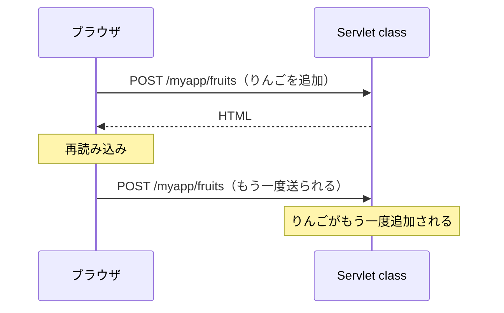
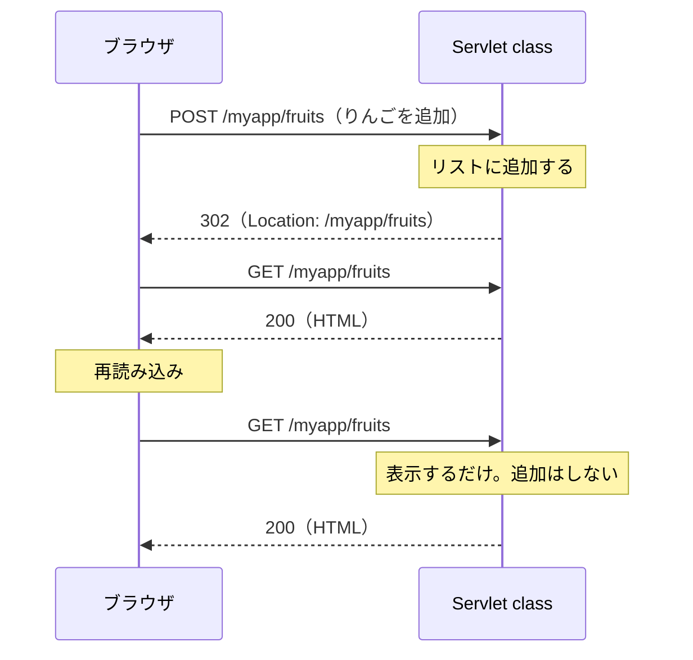

# POST の二重送信をどう防ぐのか

> 疑問: リダイレクトで直せることはわかった。では、具体的にはどう書けばよいのか。
>
> 答え: `doPost` で追加したあと、JSP に表示を任せるのをやめて、一覧へリダイレクトします。

## 再読み込みは、最後のリクエストを送り直す

[3節](03-return-result.md) で見たとおり、`POST` の返事として一覧ページを返すと、再読み込みしたときに、同じ `POST` リクエストが送り直されます。



## 追加したあとはリダイレクトする

`POST` の返事では HTML を返さず、リダイレクトします。ブラウザは `GET` でリクエストを送り直すので、今のページは `GET` の結果になります。



再読み込みで送り直されるのは `GET` なので、表示されるだけで、追加はされません。

この書き方を、`POST` → リダイレクト → `GET` の頭文字をとって、**PRG（Post/Redirect/Get）パターン**と呼びます。

## 3節の `FruitServlet` を直す

変えるのは、`doPost` の最後だけです。3節では、追加したあとに `setAttribute()` と `forward()` で一覧を返していました。この2行を、一覧へのリダイレクトの1行に置き換えます。

```java
@Override
protected void doPost(HttpServletRequest req, HttpServletResponse resp) throws IOException {
    req.setCharacterEncoding("UTF-8");

    String fruit = req.getParameter("fruit");
    if (fruit != null && !fruit.isBlank()) {
        fruits.add(fruit.strip());
    }

    resp.sendRedirect(req.getContextPath() + "/fruits");   // 一覧へリダイレクトする
}
```

`sendRedirect()` は、ステータスコード `302` で返します。引数には、リダイレクト先の URL を渡します。

仕様のとおり `303` で返したいときは、`sendRedirect()` を使わずに、`resp.setStatus(303)` と `resp.setHeader("Location", …)` を自分で書きます。

`doGet` と JSP は、3節のままです。一覧を表示するのは、`doGet` だけになります。`doPost` は追加だけを受け持ち、リダイレクトを返すようになりました。

## 気をつけること

- 表示に使う値は、`doGet` で用意する。リダイレクトの前に `setAttribute()` で入れた値は、リダイレクト先には届かない
- PRG パターンで防げるのは、再読み込みによる送り直しだけ。送信ボタンを何度も押されたときは、別の対策がいる

これで、入力を受け取り、処理して、結果を返す果物のアプリができました。

---

## 参考文献

この章では、わかりやすさを優先して説明を単純にしています。正確な仕組みや、さらに詳しい内容は次の資料で学べます。

フォームとリダイレクト:

- [フォームデータの送信（MDN）](https://developer.mozilla.org/ja/docs/Learn_web_development/Extensions/Forms/Sending_and_retrieving_form_data)
- [`<form>` 要素（MDN）](https://developer.mozilla.org/ja/docs/Web/HTML/Reference/Elements/form)
- [HTTP のリダイレクト（MDN）](https://developer.mozilla.org/ja/docs/Web/HTTP/Guides/Redirections)
- [Post/Redirect/Get（Wikipedia 英語版）](https://en.wikipedia.org/wiki/Post/Redirect/Get)

Servlet 仕様の該当する章:

- [Jakarta Servlet 6.1 仕様: HTTP Protocol Parameters（`getParameter()` で読める値）](https://jakarta.ee/specifications/servlet/6.1/jakarta-servlet-spec-6.1.html#http-protocol-parameters)
- [Jakarta Servlet 6.1 仕様: Convenience Methods（`sendRedirect()` など）](https://jakarta.ee/specifications/servlet/6.1/jakarta-servlet-spec-6.1.html#convenience-methods)

リダイレクトのステータスコードの正式な決まり:

- [RFC 9110: Redirection 3xx](https://www.rfc-editor.org/rfc/rfc9110#name-redirection-3xx)

次のステップ:

- [Jakarta EE Tutorial](https://jakarta.ee/learn/docs/jakartaee-tutorial/current/index.html)。Servlet 以外の Jakarta EE の技術も、順に学べる

---

前: [リダイレクトとは何か](04-what-is-redirect.md) ｜ [目次に戻る](../README.md)
